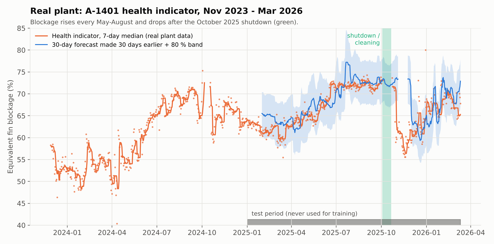
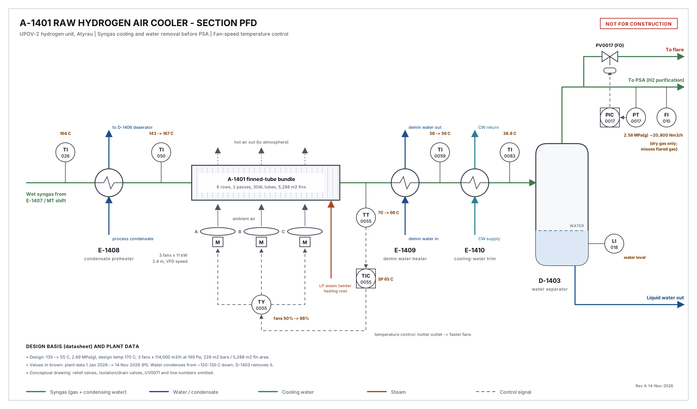
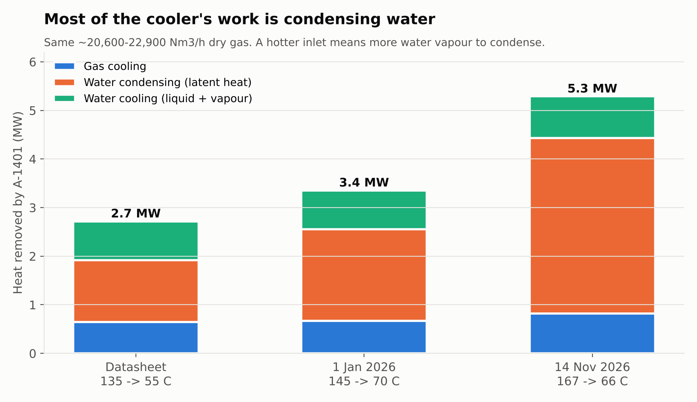
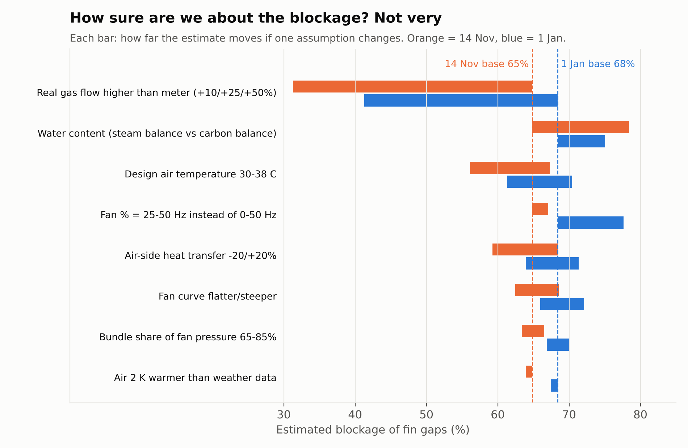
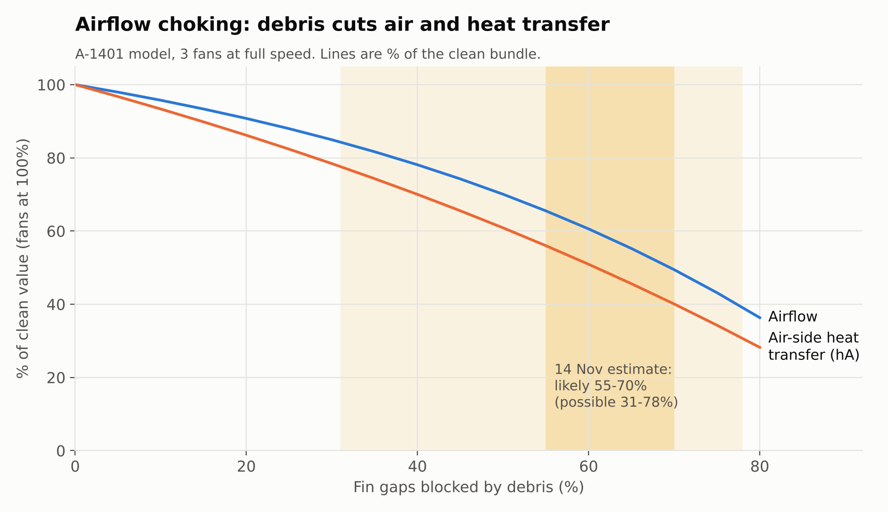
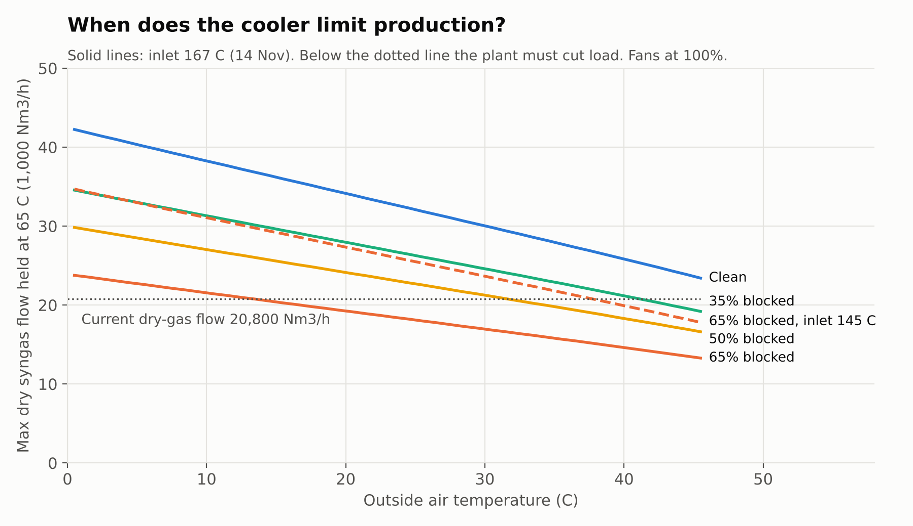
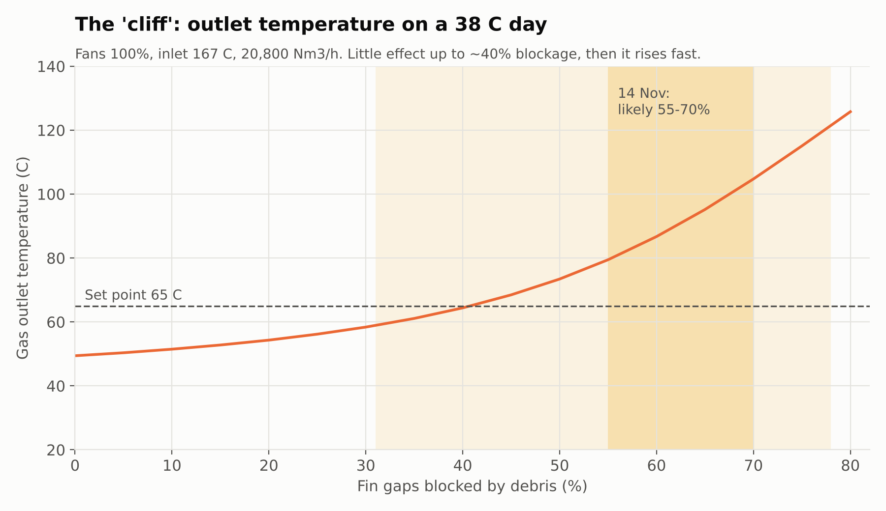

# A-1401: Process Diagram and Thermal Impact Diagnosis

*Written 14 Nov 2026 in plain language. Every number is labelled with where it comes from:*
📊 *plant data* · 📄 *datasheet / drawing* · 📖 *textbook value* · 🧮 *our calculation* · ⚠️ *assumption (see plan §8)*

Files that go with this document (all in `hackathonIndustry/`):

| File | What it is |
|---|---|
| `pfd/A-1401_section_PFD.png` / `.svg` | The process diagram (the SVG can be edited) |
| `pfd/build_pfd.py` | Script that draws it (pfd-generator skill) |
| `model/a1401_model.py` | The thermal model. Every equation is commented in plain words |
| `model/run_diagnosis.py`, `model/run_losses.py`, `model/run_uncertainty.py` | Scripts that produce all the numbers below |
| `model/uncertainty.json` | How much each answer moves when an assumption changes |
| `weather/` | Where the Atyrau weather CSV goes; `run_losses.py` reads it automatically |
| `model/results.json` | All results |
| `model/charts/1–6_*.png` | The charts for the slides (5 = how sure we are, 6 = real plant history) |
| `a1401_monitor/` | The predictive-monitoring program and its results on the real history |

Computation time on a laptop: diagnosis ≈ 4 min, loss scenarios ≈ 6 min, uncertainty runs ≈ 6 min, charts ≈ 10 s.

> **Updated after the self-audit (`AUDIT_report.md`).** Results are now shown as **ranges**, with the assumptions that move them. Where the earlier version sounded more certain than the data allows, the wording was changed. The short version: the cooler is clearly underperforming, but the exact blockage (%) and the exact tonnes of H₂ lost depend on things we were not given.

---

## Part 0. What the full plant history changed (added 14 Nov, evening)

Until now the diagnosis rested on **two snapshots** (1 Jan and 14 Nov 2026). Air Liquide's full hourly history (`plant_history/`, 14 Nov 2023 – 11 Mar 2026, 19,065 usable hours; the file repeats one frozen value after 11 Mar 2026) lets us check it. We ran the same physics model on every hour (`a1401_monitor/real_backtest.py`).

| Earlier statement | What the history says | Verdict |
|---|---|---|
| The two snapshot readings (1 Jan: 145 → 70 °C, fans 54 %; 14 Nov: 167 → 66 °C, fans 88 %) | The history has the same values for those hours | ✅ confirmed |
| "Equivalent blockage ≈ 65 %, range 31–78 %" | The model gives 50–72 % over 2.5 years and **never less than about 50 %, even right after a cleaning** | ⚠️ changed: about **50–60 % is a constant offset** (model too optimistic, louvres, or damage that cleaning doesn't fix). It is not all debris. |
| "Our two data points can't show debris building up" | The indicator **rises every May–August** (54 → 70 % in 2024, 62 → 72 % in 2025) and **fell from 72 % to 60 % after the October 2025 shutdown** | ✅ now shown: seasonal debris adds about **10–15 points**, and a cleaning wins back about **10–12** |
| "The inlet rose from 145 °C to 167 °C; maybe E-1408 is fouled" | The inlet is normally **158–166 °C**. Only 7 % of hours are below 150 °C. | ❌ corrected: **167 °C is normal; the 145 °C on 1 Jan was the unusual value.** Lowering the inlet is still a possible lever, but nothing "went wrong" upstream. |
| "The plant must cut load when the outlet passes 65 °C" (A7) | The outlet is **above 66 °C in 74 % of running hours** (median 72 °C; median 78 °C when the air is above 30 °C; maximum about 100 °C) | ❌ corrected: 65 °C is a target, not a hard limit. The plant lets the outlet drift up and leans on E-1409 / E-1410. |
| "H₂ loss 0 to 540 t/year, no evidence production was actually cut" | **Fans at 100 % for about 3,350–3,640 hours a year.** Gas flow in warm weather (air ≥ 20 °C) is far below the cool-weather flow of the same year: 20,000 vs 31,100 Nm³/h in 2024 and 17,800 vs 24,200 in 2025 | ✅ now there is evidence. If that whole gap is due to cooling, it is worth roughly **700–800 t H₂ in 2025 and 1,100–1,600 t in 2024**. This is an upper estimate: part of the gap may be lower customer demand in summer, which we cannot separate. |
| "The cliff: trouble starts sharply above ~40 % blockage" | Can't be checked directly, because the real indicator never goes below 50 % | ⚠️ keep as a model result; on the real scale, fans reach 100 % in warm weather once the indicator passes about **65 %** |
| Physics, geometry, duty, "half to two-thirds is condensation" | Not affected (they don't depend on the history) | ✅ unchanged |

### Loss of airflow and of the overall heat-transfer coefficient, from real data

The case asks for "airflow choking and the effective overall heat transfer coefficient loss". Here it is from the plant history. For each period we take the median equivalent blockage and let the model convert it to airflow and to the overall coefficient U (fans at 100 %; U is per m² of bare tube, 226 m²). 🧮 `model/real_U_loss.json`

| Period | Equivalent blockage | Airflow vs clean | Overall U | U lost vs clean |
|---|---|---|---|---|
| Clean cooler (model) | 0 % | 100 % | 527 W/m²K | – |
| Mar–Apr 2024, before the debris season | 54 % | 66 % | 375 W/m²K | 29 % |
| Aug–Sep 2024, end of summer | 69 % | 50 % | 299 W/m²K | 43 % |
| Mar–Apr 2025, before the debris season | 63 % | 57 % | 333 W/m²K | 37 % |
| Aug–Sep 2025, end of summer | 72 % | 47 % | 281 W/m²K | 47 % |
| Nov 2025, after the October cleaning | 60 % | 61 % | 349 W/m²K | 34 % |

**In plain words:**
- **One summer of debris costs about 16–20 % of the heat transfer the cooler had in spring** (375 → 299 in 2024, 333 → 281 in 2025) and about 10–16 points of airflow.
- **The October 2025 cleaning won back about 24 %** (281 → 349 W/m²K) and 14 points of airflow. It did not return the cooler to the spring 2024 level, let alone to clean.
- **The "lost vs clean" column includes the constant offset** (about 30 % even before the season). That part may be our model being too optimistic, so the season-to-season changes are the trustworthy numbers.
- Why U falls less than airflow: the air side is only about half of the total resistance to heat flow; the gas side and tube wall are not affected by debris.

**What to say on the slides now:**
1. The cooler is a real, recurring bottleneck: fans are pinned at 100 % for about 40 % of the year and the plant runs 25–35 % less gas in warm weather.
2. Debris adds about 10–15 points of blockage each summer, and cleaning removes it. This is measured, not assumed.
3. On top of that there is a constant 50–60 % that cleaning does not remove. We can't yet tell whether that is our model or a real permanent loss (bent or corroded fins, louvres, fan pitch). **An inspection of a freshly cleaned bundle would settle it.**

**Where the rest of this document is affected:** step 4 (the January paragraph), step 5 (the 65 °C limit and the 0–540 t table are now a model scenario; the measured gap above is the better evidence) and step 6 item 2 (inlet temperature). Notes are added in those places.

---

## Part 1. The process diagram (PFD)

### How to read it

- **Solid lines are pipes.** Green carries syngas (gas plus condensing water), dark blue carries water, teal carries cooling water and brown carries steam.
- **Dashed lines are control signals** (electrical, not pipes).
- **Circles are instruments.** The letters say what each one does: the first letter is what it measures (T = temperature, F = flow, P = pressure, L = level), and the next letters say what it does (I = indicates, T = transmits, C = controls, Y = calculates or relays). The number is the tag number you will find in the PI data.
- **A circle inside a square** is a controller that lives in the control-room computer (DCS).
- **Brown numbers** are the real readings: 1 Jan 2026 → 14 Nov 2026.

### What each piece does, why it matters and how it helps us

| Item | What it does | Why it matters for our case | How it helps the solution |
|---|---|---|---|
| **Wet syngas from E-1407 / MT shift** | Hot gas leaving the shift reactor (CO + H₂O → CO₂ + H₂), already partly cooled. It contains ~74 % H₂ (dry basis) and a lot of steam. | It is the "feed" of our cooler. Its temperature and water content set how much heat must be removed. | It is the starting point of the heat balance (Part 2, step 1). |
| **TI026** (164 °C) | Temperature before E-1408 | Lets us see whether E-1408 is doing its job (TI026 minus TI050). | In January, E-1408 removed 20 K (165 → 145 °C). |
| **E-1408 condensate preheater** (with bypass TIC053 / TV053 on the P&ID) | First cooling step. Hot syngas heats water going to the deaerator, so this heat is *recovered*. A temperature controller can send part of the flow around it. | If E-1408 cools less (fouled, or bypassed on purpose), everything it doesn't remove lands on A-1401. | Extra finding (Part 2, step 6): **the A-1401 inlet rose from 145 °C to 167 °C.** We don't know yet whether that is fouling or a deliberate bypass setting. |
| **TI050** (143 → 167 °C) | **Inlet temperature of A-1401** | It is one of the two temperatures we need for the heat balance. It is now 3 K below the cooler's 170 °C design limit. | Input to every calculation, and a safety point for the slides. |
| **A-1401 bundle** | 276 stainless tubes, 10.4 m long, in 6 rows. Each tube is covered with aluminium fins (5,288 m² of fin surface, 23 × the bare tube). The gas makes 2 passes. | This is where heat goes from the gas to the air, and where the **debris gets stuck** (the fin gaps are ~2 mm). | The geometry gives us the air speed, the heat-transfer coefficient and the pressure drop (step 3). |
| **Fans A, B, C** | Three 2.4 m fans, 11 kW each, push air *up* through the bundle (forced draft). Total air at full speed ≈ 342,000 m³/h. | The fans blow from below, so debris is pushed into the **underside of the bottom rows**. That is where cleaning or screens must act. | The fan curve vs. resistance gives the airflow (step 3). Forced draft also tells us where to put a screen (below, at the fan inlet). |
| **VFD** (variable-frequency drive) | A "speed knob" for each fan motor (25–50 Hz). | Fan speed is our best live signal of how hard the cooler is working. We don't know whether "88 %" means 88 % of 50 Hz or 88 % of the 25–50 Hz range; we test both. | Monitoring model input (later phase). |
| **TT0055 → TIC0055** (70 → 66 °C, set point 65 °C) | Measures the gas **outlet** temperature and compares it with the set point of 65 °C. | This is the "goal" of the cooler. When the fans are at 100 % and the outlet still rises above 65 °C, the cooler is the bottleneck. | It defines when production is limited (step 5). |
| **TY0055** (fans 50 % → 88 %) | Sends the controller's output to all three VFDs (all three get the same value). | If the gas is too hot, the fans speed up. At 100 % there is nothing left in reserve. | Today the fans are at 88 % on a cold day, so there is almost no reserve left for summer. |
| **LP steam heating row** | One extra row of steam-heated finned tubes, used in winter so the condensing water does not freeze. | In winter, the louvres (air shutters, not drawn) and this coil change the airflow, so winter data is harder to interpret. | Explains why the January data point is less reliable (step 4). |
| **E-1409 demin water heater** | Second cooling step, which heats boiler-feed water (heat recovered again). | It catches some of the heat A-1401 cannot remove. | Part of the "extra load pushed downstream" effect. |
| **TI0059** (58 → 56 °C) | Temperature after E-1409 | Shows how much E-1409 picks up. | Cross-check. |
| **E-1410 cooling-water trim** | Final cooler, using cooling water from the cooling tower. | Brings the gas to ~39 °C so that most of the water condenses before the purifier. | Its spare capacity limits how hot A-1401's outlet can be allowed to run. |
| **TI0083** (38.8 °C) | Temperature entering the separator | The PSA wants cool, dry gas. | Defines the final water content of the gas. |
| **D-1403 separator + LI018** | A tank where the liquid water drops out (gravity) and is drained. LI018 measures its level. | **This is why the representative asked about it.** The water condenses in the coolers, so half to two-thirds of the cooler's work is condensing water (step 2). | Its drain flow would *measure* how much water the gas carries, which is our weakest input. **Ask Air Liquide for it.** |
| **PT/PIC0017 → PV0017** (2.56 MPa) | Holds the plant pressure. If the pressure rises, PV0017 opens and sends gas to the **flare**. | Gas sent to the flare passed through our cooler but is **not counted** by FI010. | That is why FI010 under-reads (Hint 1). On 14 Nov PV0017 was at 0 %, so that day's FI010 reading is OK. |
| **FI010** (~20,800 Nm³/h) | Flow meter on the dry gas going to the PSA. | It is our flow measurement, but it shows only dry gas and misses any flared gas. | We use it when the flare is closed (as on 14 Nov). If the true flow were higher, our blockage estimate goes *down* (step 4). |
| **To PSA M-1405** | Pressure-swing adsorption, which purifies H₂ to 99.8 %. | Making H₂ is the reason the plant exists. Lost flow = lost revenue. | We turn lost flow into lost hydrogen and money (step 5). |

**Assumption on the drawing:** PV0017 is drawn as "fail open" (it opens to the flare if air or power is lost), which is normal for pressure relief to a flare. This is not confirmed by the data.

---

## Part 2. Thermal impact diagnosis, step by step

### Step 1. Rebuild the geometry from the datasheet

**What:** the datasheet gives the areas (226 m² bare, 5,288 m² fins) but not the fin dimensions. We pick standard fin sizes and check that they reproduce both areas.

| Quantity | Value | Source |
|---|---|---|
| Tube outside / inside diameter | 25 / 21 mm | 📄 datasheet |
| Number of tubes × length | 276 × 10.42 m = 2,876 m | 🧮 from 226 m² ÷ (π × 0.025) |
| Fin outside diameter, thickness | 57 mm, 0.4 mm aluminium | ⚠️ A12, **assumed** (a common size for this fin-area ratio; the bundle drawing would confirm it) |
| Fins per metre | 423 (≈ 10.7 per inch) | 🧮 solved so the fin area = 5,288 m² |
| **Gap between fins** | **2.0 mm** | 🧮 (follows from the assumed fin size) |
| Face area the air enters through | 30.7 m² | 🧮 |
| Open fraction at the narrowest point | 52 % | 🧮 |

**Result:** the model's areas are 5,289 m² fins and 226 m² bare, matching the datasheet. Note that *other* fin sizes could match the two areas too, so the 2 mm gap is our best guess, not a measurement.

**What it means:** a gap of about 2 mm is the size of a poplar seed tuft or an insect leg. It is clear why debris gets trapped.

### Step 2. How much heat must the cooler remove? (process side)

**Chemistry used:**
- **Dalton's law plus vapour pressure.** If the gas carries more water than it can hold as vapour, it is *saturated*: the water vapour in the gas is y(H₂O) = p_sat(T) / P_total, and the rest is liquid droplets. When the gas cools, p_sat drops and more water condenses.
- **Enthalpy:** dry-gas heat capacity (ideal-gas Cp of each component) + latent heat of water (steam tables via CoolProp) + liquid water heat capacity.

**The weakest input: how much water is in the gas** ⚠️ A6

- **What we used:** the steam balance on the PFD. Steam in = 15,494 kg/h = 860 kmol/h. Water used up by the reactions = the oxygen atoms that ended up in CO₂ and CO = 350 kmol/h. So **≈ 510 kmol/h of water** leaves with 919 kmol/h of dry gas, a ratio of 0.555 mol water per mol dry gas.
- **The problem:** a second check on the same PFD does **not** agree. Counting carbon atoms, the natural gas + LPG feed carries about **480 kmol C/h**, but the syngas leaving carries only about **229 kmol C/h**. That is a factor of 2. Probably part of the feed goes somewhere we can't see (for example, fuel to the burners), but we can't confirm it. So the water number rests on the steam balance alone.
- **Why it matters:** if the gas is saturated at the inlet (needs at least 0.36 mol water per mol dry gas at 167 °C), most of the duty is condensation. If there is less water, the duty is smaller:

| Water / dry gas (mol/mol) | Where it comes from | 14 Nov duty | Share that is condensation |
|---|---|---|---|
| **0.555** | PFD steam balance (our base case) | **5.3 MW** | 68 % |
| 0.45 | −20 % | 5.1 MW | 71 % |
| 0.36 | just saturated at 167 °C | 4.9 MW | 73 % |
| 0.24 | if the true dry flow were 1.5× higher (carbon balance) | 3.5 MW | 67 % |

**→ 14 Nov duty is 3.5 to 5.3 MW**, with 5.3 MW if the steam balance is right. **The direct way to settle this is the condensate drain flow from D-1403. We should ask Air Liquide for it.**

**Results for the base case** 🧮 (chart 2):

| Case | Inlet → outlet | Dry gas | Duty | Gas cooling | Water condensing | Water condensed |
|---|---|---|---|---|---|---|
| Datasheet | 135 → 55 °C | 20,588 Nm³/h | 2.7 MW | 0.64 MW | 1.28 MW | 2.0 t/h |
| P&ID operating values | 137 → 60 °C | 20,588 Nm³/h | 2.7 MW | 0.62 MW | 1.35 MW | – |
| 1 Jan 2026 📊 | 145 → 70 °C | 22,862 Nm³/h | 3.4 MW | 0.67 MW | 1.88 MW | 3.0 t/h |
| **14 Nov 2026 📊** | **167 → 66 °C** | **20,801 Nm³/h** | **5.3 MW** | 0.82 MW | **3.61 MW** | **5.9 t/h** |

(The P&ID shows a second design reference, 137 → 60 °C. It gives the same duty as the datasheet, so the two drawings agree.)

**Interpretation:**
- **Half to two-thirds of the cooler's work is condensing water** (47 % at design, 56 % on 1 Jan, 68 % on 14 Nov), not cooling gas. Treating the gas as dry would underestimate the duty **4 to 6 times**.
- **The inlet temperature has a huge effect.** Going from 145 °C to 167 °C almost doubles the water vapour entering (3.2 → 6.1 t/h), because vapour pressure rises exponentially with temperature (Clausius–Clapeyron). That is why the duty is **5.3 MW instead of 3.4 MW**, with *less* gas.

**How it helps the solution:** there is an *upstream* lever to investigate. If the A-1401 inlet were back at ~145 °C, its duty on 14 Nov would fall by about **41 %** (5.3 → 3.1 MW). But the P&ID shows a temperature-controlled bypass around E-1408 (TIC053 / TV053), so the hot inlet might be a deliberate setting (for example, to protect the condensate side), not fouling. We need TI026 for November and the bypass position before calling it a fix.

### Step 3. The clean cooler model (air side + tube side)

**Air side, in plain words:**
1. **How much air flows?** A fan can push more air when the resistance is low and less when it is high, which is its *fan curve*. The bundle's resistance rises with the square of the airflow, which is the *system curve*. The airflow is where the two curves cross. ⚠️ A3: we have no real fan curve, so we use a **generic** axial-fan shape through the datasheet point (114,000 m³/h at 190 Pa per fan). The datasheet's 190 Pa is a *total* pressure, which includes about 28 Pa of "velocity pressure" at the fan; we let the bundle take 75 % of it, and we test 65–85 % in the sensitivity.
2. **How well does the air pick up heat?** We use the **Briggs & Young** correlation, a fitted equation from experiments on finned tubes: Nu = 0.134·Re^0.681·Pr^(1/3)·(s/l)^0.2·(s/t)^0.1134. Re (Reynolds number) measures how fast and turbulent the air is, Pr is an air property, s is the fin gap, l is the fin height and t is the fin thickness. Correlations like this are typically good to about ±20 %, so we test that too.
3. **Fin efficiency.** A fin is hotter at its root than at its tip, so the tip works less. With the Schmidt formula for round fins we get **η_fin = 0.86**: the fins work at 86 % of an ideal fin.
4. **Tube side:** a gas film coefficient (Gnielinski equation) corrected for condensation in the presence of hydrogen, which doesn't condense (Silver–Bell–Ghaly method). This gives ≈ 2,200 W/m²K.
5. **Adding the resistances** (like resistors in series): 1/UA = 1/UA_air + 1/UA_tube + R_wall. The air side is **52 % of the total resistance**, the tube side 41 % and the wall 7 %. That is why air-side fouling hurts so much.
6. **Rating (zone method):** we walk along the cooling curve in 0.5 K steps. At each step we know the heat released and the gas and air temperatures, so we compute the area needed and add it up. If the total equals the real area, the outlet temperature is right.

**Clean results** 🧮 (fans 100 %):

| Quantity | Value |
|---|---|
| Airflow | 95 m³/s (342,000 m³/h), face velocity 3.1 m/s, 5.9 m/s in the gaps |
| Air-side coefficient h | 49 W/m²K (Re ≈ 8,400) |
| Fin / surface efficiency | 0.86 / 0.86 |
| Air-side conductance UA_air | 224 kW/K |
| Overall UA | ≈ 119 kW/K |
| Fan power | 9.3 kW per fan (we *assumed* 65 % fan efficiency, so this being below the 11 kW motor is not an independent check) |

**Consistency check with the datasheet (not a full validation):** the datasheet gives the design temperatures (135 → 55 °C) but **not the design air temperature**. With our equations, a clean cooler at **35 °C** air handles up to 36,300 Nm³/h, which is close to the plant's 100 %-load flow (20,588 ÷ 0.584 = 35,260 Nm³/h). So the model is **consistent with the datasheet if the design air temperature was about 35 °C**. If it was 30 °C, the model would be about 15 % too optimistic; if it was 38 °C, about 4 % too pessimistic. We can't tell which, so in the uncertainty runs we re-tune the model to each case (30, 35 and 38 °C) and see how the answers move.

**What it means:** at today's 58 % load, a clean A-1401 should have plenty of spare capacity. If it is struggling, something is wrong.

### Step 4. The fouled model and what the plant data says

**How we model debris** ⚠️ A10:
- A fraction **φ** of the fin gaps is blocked. The air must squeeze through the remaining (1 − φ). This raises the resistance (bundle ΔP × (1 − φ)^−1.684, the Robinson–Briggs velocity exponent), so the fans deliver less air.
- The blocked part of the surface does no work, so the active area is × (1 − φ).
- Optionally, a debris mat adds insulation R_d (m²K/W), in series with the air film.

**Calibration to the plant (14 Nov 2026)** 📊: inlet 166.8 °C, outlet 66.4 °C, flow 20,801 Nm³/h (flare closed, PV0017 = 0 %), fans 87.9 %, air 6.5 °C (Open-Meteo forecast archive for 14 Nov 15:00, A9).
- A **clean** cooler under those conditions would cool the gas to about **16 °C**. The real outlet is 66 °C.
- **Cleanliness factor** CF = UA_actual / UA_clean ≈ **0.49**: the cooler works at about half its clean capability (base case).
- **Equivalent blocked fraction, base case φ ≈ 65 %.** The airflow is cut to 55 % of clean, and air-side heat transfer to 46 % of clean.
- If we blame insulation only (φ = 0), we would need R_d ≈ 0.047 m²K/W. That is very large compared with ordinary design fouling allowances for air coolers, which are of the order of 0.001 m²K/W or less (order of magnitude only; we did not find a single authoritative source). **So the problem is most likely blocked airflow rather than insulation,** which also matches the visual inspection.

**How sure are we about the 65 %? Not very.** It comes from **one** snapshot, and several inputs are guesses. We changed each guess on its own and re-solved (🧮 `run_uncertainty.py`, chart 5):

| What we change | φ on 14 Nov | φ on 1 Jan |
|---|---|---|
| **Base case** | **65 %** | **68 %** |
| Real gas flow 10 / 25 / 50 % higher than FI010 | 59 / 50 / 31 % | 64 / 56 / 41 % |
| Water content lower (0.36 / 0.24 mol/mol) | 69 / 78 % | 73 / 75 % |
| Design air temperature 30 / 38 °C (model re-tuned) | 56 / 67 % | 61 / 70 % |
| Air-side heat transfer −20 / +20 % | 59 / 68 % | 64 / 71 % |
| Fan % means 25–50 Hz instead of 0–50 Hz | 67 % | 78 % |
| Fan curve flatter / steeper | 62 / 69 % | 66 / 72 % |
| Bundle takes 85 / 65 % of fan pressure | 63 / 67 % | 67 / 70 % |
| Air 2 K warmer than the weather data | 64 % | 67 % |

**→ The possible range is about 31–78 %; the most likely range is about 55–70 %.** The biggest unknown is the true gas flow: on 14 Nov the flare was closed, so FI010 should be right, but if it under-reads by 25 % or more, the blockage could be as low as 30–50 %. Every case agrees on the main message: **the cooler is working at well below its clean capability.**

> **Update from the full history (Part 0):** the January value is part of a constant 50–60 % offset that is there all year, and the seasonal rise is now visible in the real data. Read the paragraph below with that in mind.

**1 Jan 2026, honestly:** the same method gives about **68 %** in January, which is **the same as or slightly more than November.** Taken at face value, the cooler did **not** get dirtier between January and November. The rise in fan speed (≈ 50 % → 88 %) is explained mostly by the **hotter inlet** (3.4 → 5.3 MW), not by new debris. Possible reasons, which we cannot yet tell apart:
1. The bundle was already fouled from summer 2025 and was not cleaned over the winter.
2. In winter the louvres (air shutters) may be partly closed to stop the condensate freezing, which looks like blockage to the model. We have **no louvre-position data** to confirm this.
3. Our clean model may be too optimistic (see the design-air check in step 3), so it "sees" fouling that is partly not there.

Either way, this weakens the simple "debris builds up every summer" story.

**New information (Air Liquide, 14 Nov): the cooler was cleaned in September 2025 and again during the turnaround at the end of June / beginning of July 2026.** So on 1 Jan 2026 the bundle was only about 4 months after a cleaning, through autumn and early winter when there is little debris, yet the model still says about 68 %. That makes reason 1 unlikely and points to reasons 2 and 3 (louvres, or a model that is too optimistic), or to cleaning that did not reach the debris (for example, washing from the top only, while debris sits under the bottom rows). **What this means:** part of the "65 %" in November may be a constant offset (louvres or model error) rather than debris. The true debris part could be smaller. Ask how the cooler is cleaned (from above or below, water or air), and whether the louvres were partly closed on 1 Jan. **We need either a cleaning date or a summer data point** to see how fast the fouling grows.

**Honest caveat:** "equivalent blockage" includes **everything** that reduces airflow: debris, louvre closure, fan blade or belt wear, and hot-air recirculation. Only an inspection can split these. The model tells Air Liquide **roughly how much** air is missing; the visual inspection says **why**.

### Step 5. Impact: when and how much production could be lost

**Question:** at full fan speed, what is the largest gas flow the cooler can still bring down to 65 °C, at each outside temperature? If it is less than today's 20,800 Nm³/h, the plant must cut load (⚠️ A7).

**Weather:** real hourly air temperature for Atyrau (47.12 °N 51.92 °E) from the ERA5 reanalysis via Open-Meteo, 1 Jan 2025 – 13 Nov 2026 (A8). `run_losses.py` reads the CSV from `weather/` if it is there; otherwise it uses hour counts made from the same download.

> **Update from the full history (Part 0):** the plant does not hold 65 °C as a hard limit, so the table below is a *model scenario*. The measured evidence is stronger: fans at 100 % for about 3,350–3,640 h a year and 25–35 % less gas flow in warm weather.

**The answer depends strongly on two things we don't know for the summer: how blocked the bundle is, and how hot the inlet is.** So we give scenarios rather than one number:

| Scenario (fans 100 %, outlet held at 65 °C) | Production limited when air is above | Hours limited, 2025 | H₂ lost, 2025 (upper bound) | Hours limited, 2026 Jan–13 Nov | H₂ lost, 2026 (upper bound) |
|---|---|---|---|---|---|
| Clean bundle, inlet 167 °C | never (up to 45 °C) | 0 h | ≈ 0 t | 0 h | ≈ 0 t |
| 35 % blocked (after a partial clean), inlet 167 °C | about 41 °C (hotter than any hour in the data) | 0 h | ≈ 0 t | 0 h | ≈ 0 t |
| 50 % blocked, inlet 167 °C | about 32 °C | 350 h | ≈ 15 t | 446 h | ≈ 22 t |
| 50 % blocked, inlet back to 145 °C | never (up to 45 °C) | 0 h | ≈ 0 t | 0 h | ≈ 0 t |
| 56 % blocked, inlet 167 °C | about 26 °C | 1,434 h | ≈ 90 t | 1,509 h | ≈ 104 t |
| 65 % blocked (base case), inlet back to 145 °C | about 38 °C | 14 h | ≈ 0 t | 49 h | ≈ 1 t |
| **65 % blocked (base case), inlet 167 °C: today's state all year** | about 13 °C | 4,384 h | ≈ 539 t | 4,536 h | ≈ 557 t |
| 70 % blocked (worse than today), inlet 167 °C | about 3 °C | 6,297 h | ≈ 1,081 t | 5,871 h | ≈ 1,086 t |

**How to read it:** the rows are *what-if* states of the bundle, all on our base model. (They are not the same thing as the uncertainty in step 4: when we re-tune the model to a different design air temperature, the estimated % changes, but the temperature at which today's cooler becomes limiting stays at about 13 °C, because it is tied to the real 14 Nov observation.) Blockage matters enormously near today's level. Going from 65 % to 56 % cuts the upper-bound loss from about 540 t to about 90–100 t; going to 50 % cuts it to about 15–22 t; at 35 % there is no loss in any hour we have. A cooler inlet (145 °C) has almost the same effect as cleaning. The 70 % row is a warning, not a forecast: within our base model it would already be limited above about 3 °C, which doesn't fit the 14 Nov observation, so it only shows what happens if fouling gets *worse*.

🧮 H₂ lost = lost dry gas × 74.4 % H₂ × 79.6 % PSA recovery (back-calculated from the PFD: 12,200 ÷ (0.744 × 20,588)) × 0.0899 kg/Nm³.

**Every number in this table is an upper bound for its scenario.** It assumes:
- the plant would otherwise run at 20,800 Nm³/h every hour of the year;
- the plant must hold the outlet at 65 °C (in reality operators may let it run hotter and lean on E-1409 and E-1410);
- the blockage and inlet temperature stay the same all year.

We have **no summer plant data** showing that production was actually cut in 2025 or 2026. And because the cooler was **cleaned at the start of July 2026** (and in September 2025), the "today's state all year" row cannot have happened in reality: for most of the hot season the bundle was much cleaner than today. So the honest summary is: **somewhere between about 0 t (inlet back near 145 °C, or blockage at or below 35 %) and about 540 t of H₂ per year (upper bound, if today's 65 % and 167 °C persisted all year).** The *temperature* at which trouble starts, about 13 °C with today's state, is more solid than the tonnes, because it is tied to the real observation of fans at 88 % on a 6.5 °C day.

**On a 38 °C summer day** (inlet 167 °C, fans 100 %): clean → 49 °C outlet; base-case fouling (65 %) → **95 °C outlet**, 30 K above the set point.

**Interpretation, the "cliff":** the outlet temperature barely moves until about **40 % blockage**, then shoots up. That would explain why the problem seems to "appear suddenly" in summer. It also means that **removing even part of the debris recovers a lot**: going from 65 % to 35 % blockage removes the bottleneck at today's load in every weather hour we have.

### Step 6. Side effects found along the way

1. **Fan power *may* fall when the bundle clogs.** In our model it drops from 9.3 to 7.2 kW per fan at 100 % speed (65 % blocked), because an axial fan moving less air can draw less power. But this comes from our *generic* fan curve, and many real fans draw about the same power, or more, as they approach stall. Even in the model the change is tiny until blockage is severe (9.2 kW at 30 %, 8.5 kW at 50 %). **To be confirmed with real fan current data; not useful for early warning on its own.**
2. **Corrected by the full history:** the inlet is normally 158–166 °C; the 145 °C on 1 Jan was the exception. *Earlier text:* **The inlet temperature rose from 145 °C to 167 °C between January and November.** E-1408 may be fouled, its bypass (TIC053 / TV053) may be more open, or upstream conditions changed. Request TI026 for November and the TV053 position.
3. **The inlet is 3 K below the 170 °C design temperature** (📄 datasheet, 📄 inspection certificate). Any solution that raises the inlet further is not allowed.
4. **A hotter A-1401 outlet pushes load onto E-1409 and E-1410** (cooling water), and on the hottest days wetter gas could reach the PSA.

---

## Part 3. What the diagnosis tells us about the final solution

| Finding | How sure | Design consequence |
|---|---|---|
| The cooler works well below its clean capability (CF ≈ 0.5 in the base case) | Fairly sure: every variant of the model agrees | Something must be done; the question is how much and where. |
| Blocked **airflow** matters more than insulation | Likely (needs R_d 0.047, far above normal fouling allowances) | A solution should **keep the gaps open or reopen them**: screens, air or water cleaning. Fin coatings that only improve heat transfer won't help much. |
| Forced draft: air enters from **below** | Sure (datasheet) | Debris collects on the **underside of the bottom rows**. Screens go at the fan inlet or under the bundle, and cleaning nozzles must reach the bottom rows. |
| "Cliff" at ~40 % blockage | Shape is robust; the exact % depends on the model | The goal isn't a perfectly clean cooler; it is to **stay below roughly 35–40 % blockage** all summer. |
| A hotter inlet means much more water to condense | Sure on the physics; but 158–166 °C is the plant's normal inlet | **A possible upstream lever:** an inlet near 145 °C would cut A-1401's duty by about 41 %, if E-1408 and its bypass allow it. |
| Seasonal rise of 10–15 points each May–August, on top of a constant 50–60 % | Measured on 2.5 years of real data | Solutions must (a) stop or remove the seasonal debris and (b) include an inspection of a freshly cleaned bundle to explain the constant part. |
| Water content not confirmed (PFD carbon balance off 2×) | Uncertain | Ask for the D-1403 condensate flow; duty is 3.5–5.3 MW until then. |
| Fan current might fall as it clogs | Unconfirmed (assumed fan curve) | Monitoring should use **outlet temperature + fan speed + inlet temperature + weather** first; add fan current only if real data shows a trend. |
| Model consistent with the datasheet if design air ≈ 35 °C | Consistency check, not validation | Use the model to **compare** solutions, and show each result as a range. |

## Assumptions specific to this step (adds to plan §8)

| Assumption | Value | Why it is reasonable | How much it matters |
|---|---|---|---|
| Fin size | 57 mm OD, 0.4 mm Al, 423 fins/m | Reproduces both datasheet areas; other sizes could too | Changes the gap and h; covered by the ±20 % on h |
| Tube pitch | 64 mm triangular | Common for 57 mm fins; gives 46 tubes per 3 m row, consistent with the 3 m bundle width | Small |
| Process pressure | 2.75 MPa abs | Between the datasheet inlet (2.69 MPa g) and D-1403 (2.56 MPa g) | Small |
| Water/dry-gas ratio | 0.555 mol/mol | PFD steam balance only; the PFD carbon balance does not close | **Large**: duty 3.5–5.3 MW, φ 65–78 % |
| Condensate film coefficient | 8,000 W/m²K | A typical order of magnitude for thin water films | Halving it moves φ by about 2 points |
| F-factor | 0.95 | Usual value for a 2-pass cross-flow air cooler | Small |
| Fan efficiency | 65 % | Typical order for this fan size | Only affects fan power, not φ |
| Fan curve | generic shape (a = 1.6, b = 0.6) | No real curve available | φ 62–69 % |
| Design air temperature | 35 °C | Not stated on the datasheet | φ 56–67 % |
| 1 Jan flow | average of 00:00–02:34 (all the FI010 data we have) while temperatures average 00:00–08:00 | That is all the flow data | Small if the flow was steady |
| Production limit | Outlet held at 65 °C (screenshot set point) | Gives an upper bound on lost H₂ | Large for the tonnes |
