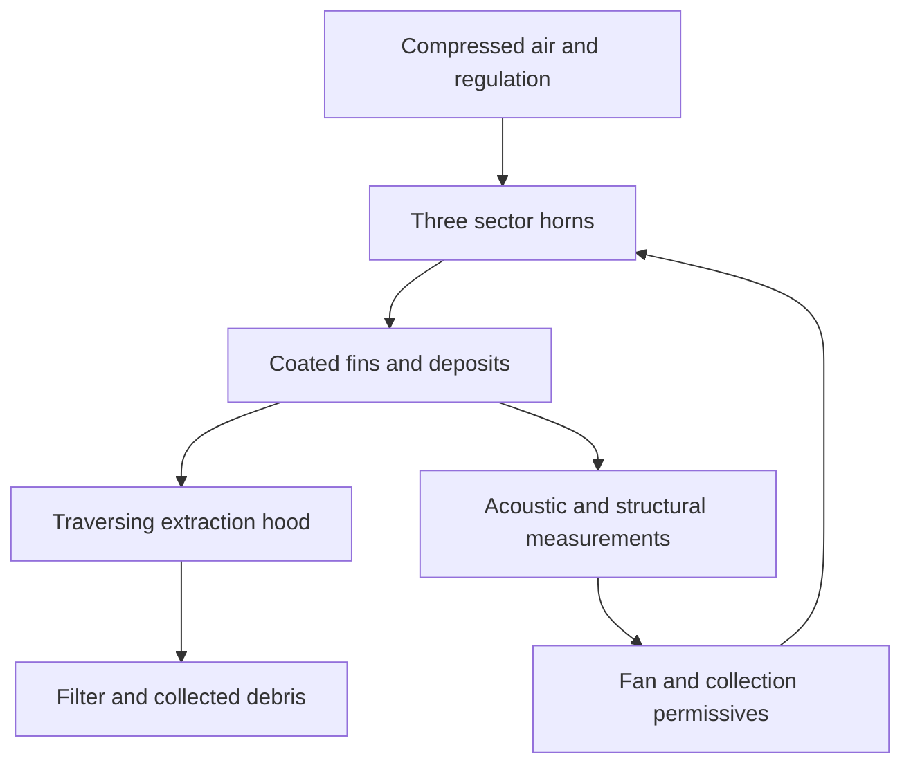
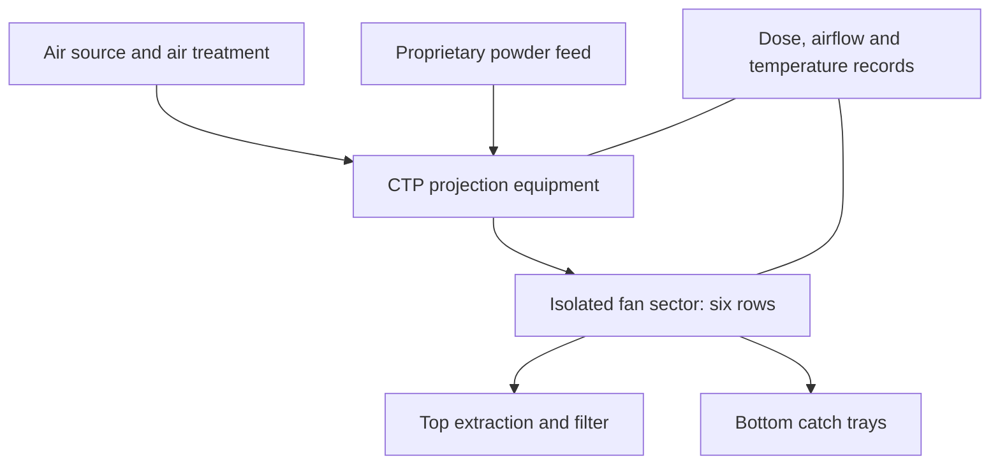

# A-1401 — Detailed preliminary engineering designs and protocols

**Revision 2 — airborne sonic architecture • 15 November 2026 • For engineering review and subsequent calculations**

> **Corrected 15 November 2026.** Thermal results in §9–§10 now come from the project's wet (condensing) rating model `a1401_clean_vs_fouled/` and the solution simulation `a1401_solutions_check/simulate_solutions_v2.py` (`SIMULATION_REPORT_v2.md`), starting from the fitted plant state instead of an assumed 30 % blockage. Sources were re-opened; private links were removed. Every change is listed in `CHANGES_v2.md`. Design, protocol and resource sections are unchanged except where marked.

## 1. Purpose and engineering status

This document specifies two selected interventions for external cottonwood, pollen, insect and dust fouling of A-1401: **an O2T8 octyl-silica coating with airborne low-frequency acoustic horns and vacuum collection**, and **CTP's DECAMEX® dry cleaning service**. It includes equipment-specific geometry, proposed hardware, chronological protocols, material and utility calculations, and numerical post-treatment scenarios on the project's wet thermal model (corrected; the supplied sensible-only script is superseded).

**The designs have different maturity.** Solution 1 is a research development proposal: no cited study demonstrates this complete system on a six-row industrial syngas cooler. Solution 2 is an established industrial service, but its effectiveness on this particular organic deposit and its project-specific consumptions are unverified. DECAMEX is the stronger candidate for a near-term field trial; the coating system merits a representative fin-section experiment before a bundle retrofit.

Parts 6 and 7 of the attached assignment—economic input registers and formal hazard-assessment registers—are deliberately omitted. Physical quantities, process conditions, equipment restrictions and technical failure criteria remain because the designs would otherwise be incomplete. There are no monetary estimates, risk scores or released plant operating instructions.

### Evidence labels used throughout

| Label | Meaning |
|---|---|
| **DOCUMENTED — D** | Specification read from an original supplied engineering document; not necessarily a present operating measurement. |
| **MEASURED/RECORDED — M** | Recorded value, with its instrument, time and measurement boundary retained. |
| **RESEARCH/VENDOR — R/V** | Published experimental finding or vendor statement, explicitly attributed. |
| **PROPOSED — P** | Our design choice or analytical assumption; requires validation. |
| **CALCULATED — C** | Derived from identified D, M, R/V or P inputs; inherits their uncertainty. |
| **UNKNOWN — U** | Not established by the supplied evidence. A blank is not zero. |

Low/base/high scenarios are **sensitivity cases, not confidence intervals or supplier guarantees**. Resource cases and effectiveness cases are independent: buying more powder or electricity does not automatically produce the optimistic cleaning outcome.

## 2. Equipment and operating basis

### 2.1 Verified specifications used in these designs

Page numbers below are PDF pages, counted from 1. Original assembled-dossier page numbers are additionally given where visible. Source filenames are listed in §11.

| Parameter | Value and classification | Exact source location and interpretation |
|---|---|---|
| Equipment | A-1401 raw hydrogen/syngas air cooler; one main bundle — D | E01 p.1, assembly BOM and nominal table; E04 p.2, identity. |
| Main process tubes | 276; OD 25 mm; wall 2 mm; length 10,500 mm — D | E04 p.5, finned-tube component row; E02 p.1, BOM item 31 and tube specification. |
| Main tube material | 00Cr19Ni10 / S30403 stainless steel — D | E02 p.1, fabrication note 2.3 and tube specification; E04 p.5 component material. |
| Arrangement | Six tube rows; two tube passes — D | E02 p.1, nominal table and cross-section C–C; E01 nominal table. |
| Row grouping | Two groups of three rows visible — D interpretation of section | E02 p.1, section C–C. This informs row-resolved acoustic measurements; it does not establish an acoustic mode. |
| Transverse tube pitch | 62 mm — D | E02 p.1, section C–C, boxed 62 and chain 45.5 × 62 = 2,821 mm. **This is tube pitch, not fin pitch.** |
| Bundle envelope used for footprint | 10,592 ± 6 mm long × 2,980 +0/−4 mm wide — D | E02 p.1, longitudinal overall dimension and C–C width. Includes structure/header envelope; not net free-flow area. |
| Cross-section structural depth | 590 mm — D | E02 p.1, outside dimension at C–C. Not the sum of fin diameters or an available access clearance. |
| Support spacing relevant to structural response | Five 1,500 mm spans = 7,500 mm between six support stations — D | E02 p.1, longitudinal dimension chain, `5×1500±1.5=7500±4`. End overhangs also require modal coverage. |
| Bare and finned surface entries | 226 m² and 5,288.4 m² — D | E01/E02 p.1, nominal heat-transfer-area rows. Whether 5,288.4 includes exposed base surface is unresolved. |
| Empty main vessel/bundle mass | 10,277 kg — D | E04 p.3, empty-vessel mass; used for workshop heating estimate. Not the lifting weight of the whole fan/enclosure assembly. |
| Working/design pressure | 2.69 / 4.0 MPa — D | E04 p.3, pressure rows; E01/E02 nominal tables. Preserve the plant's gauge/absolute convention when using these outside this report. |
| Nominal fluid temperatures | 135°C inlet / 55°C outlet — D | E04 p.3, medium working temperature. Not a measured clean operating test. |
| Design wall temperature / minimum permissible wall temperature | 170°C / −38°C — D | E04 p.3, respective temperature rows. Not the measured fin-temperature distribution. |
| Fans | Three, nominal diameter 2.4 m, 477 rpm — D | E06 p.32, fan technical table (original p.204/323); E01 p.1. |
| Nominal fan airflow | 114,000 m³/h each; 342,000 m³/h total — D/C | E06 p.32; sum of three ratings. Actual installed airflow is unknown. |
| Fan motors | 11 kW each; 33 kW installed total — D/C | E06 p.32 and E01 p.1. Motor rating is not measured electricity consumption. |
| Fan pressure conflict | 190 Pa in general drawing; 170 Pa in fan certificate — D conflict | E01 p.1 versus E06 p.32. Neither is a verified main-fin-pack static pressure loss or spare pressure margin. |
| Separate heating bank | 26 tubes, OD 25 × 2.5 mm, grade 10 carbon-steel base tubes; tabulated areas 21.3/498.4 m² — D | E03 p.1 BOM item 13 and nominal table; E06 p.8 material register. **Excluded from both treatment quantities.** |
| Main fin material and geometry | Exact alloy, fin thickness, pitch, OD and attachment/contact condition — U | The material of the stainless base tube does not establish fin material. Aluminium is the provisional substrate for Solution 1, pending OEM/field confirmation. |

The carbon-steel certificates in **E06 concern the heating bank**, not proof that the main syngas tubes are carbon steel. An aluminium calibration-block checkbox in an NDT report is not a fin-material certificate. Original manufacture also does not prove that no later retubing occurred.

Fans move ambient air; fins are passive extended heat-transfer surfaces around the tubes. Neither intervention contacts the internal syngas intentionally. The stream is a gas mixture, potentially containing water vapour and condensate—not a pure chemical substance. The supplied process display shows further cooling and downstream separator D-1403. A sensible-only model therefore omits potentially important latent heat and changing vapour composition.

### 2.2 What the historical records actually establish

Original historian exports generally contain **3,600 numerical events per tag**, not complete January–November records. Timestamps below are as stored; their time zone is not independently established.

| Export/tag | Actual first-to-last record | Limitation |
|---|---|---|
| TIA050 | 1 Jan 00:01:50 to 3 Jan 09:42:39, 2026 | Inlet-temperature record only; one duplicate timestamp. |
| TICA0055 `.pv` | 1 Jan 00:00:09 to 1 Jan 08:23:48 | Outlet-temperature record. `.mv` is a different controller variable. |
| FI010 | 1 Jan 00:00:01 to 1 Jan 02:34:35 | Flow toward M-1405 downstream of D-1403/flare split; cannot automatically represent cooler inlet flow. |
| PICA0017 | 1 Jan 00:00:08 to 2 Jan 00:13:47 | Downstream pressure, not an A-1401 pressure-drop measurement. |
| TIA0059 | 1 Jan 00:00:05 to 1 Jan 14:03:20 | Associated with downstream E-1409 region; not substituted for A-1401 outlet. |
| TY0055 A/B/C | 1 Jan 00:01:20 to 2 Jan 00:06:33 | Repeated/equal series and export-layout duplication require checking; not three independent airflow measurements. |
| TIA026 | 1 Jan 00:04:21 to 8 Jan 15:09:58 | Separate temperature tag; does not fill missing summer cooler history. |
| D-1403 laboratory workbook | 56 dated rows from 1 Jan to 12 Nov; 55 with composition data | Sparse samples, including summer dates; not continuous summer operating history. Source worksheet is not consistently chronological. |

For example, the laboratory sheet's **row 5, 1 January 08:00**, records H₂ 74.33%, O₂ 0.01%, CO 2.11%, CO₂ 17.87%, N₂ 0.46%, CH₄ 5.22% by volume. These downstream values are real source data but are not simultaneous with the model's three hourly snapshots and do not quantify inlet water.

The PI Vision image is a separate snapshot: approximately 166.78°C at TIA050, 66.4°C at TICA0055 and 20,801 Nm³/h at FI010. These are approximate visual readings, not a calibrated before/after test. Aksel's accompanying warning states that the flowmeter is correct for the relevant cooler-flow inference only when no gas is flared. Fan-control indications around 87.887 must not be converted into rpm or flow without their calibration/control logic.

**Correction from the subsequently located full-history workbook:** `Data (full history) (1).xlsx`, sheet `SheetJS`, contains hourly data from 14 November 2023 to 1 October 2026. For June/July/August 2026 it has 720/744/744 rows respectively, all with numerical TIA050, TICA0055_pv, TICA0055_mv, PICA0017_mv and FI010 values. Thus **summer temperature/flow-proxy records do exist**; the earlier conclusion based only on the short individual exports must not be applied to this larger workbook. Numerical presence is not instrument-quality validation: controller `.mv` values are not pressure or airflow, and the dataset has processed `included` status records.

The remaining limitation is absence of a complete **summer heat-balance/air-side measurement set**: no simultaneous ambient intake/recirculation, measured fan airflow, wet inlet flow, condensate balance, clean reference or cleaning chronology was established. (Correction: the project has analysed this full history with its wet model. The equivalent blockage rises by 9–12 points each May–June; the October 2025 cleaning took it from 0.682 to 0.557 and the 27 Jun – 7 Jul 2026 turnaround cleaning to 0.574 for Jul–Sep 2026. The outlet target was moved to about 60 °C (Mar–Jun), 70 °C (Jul) and 65 °C (Aug–Sep) in 2026. See `a1401_clean_vs_fouled/REPORT.md` and `A-1401_PFD_and_thermal_diagnosis.md` Part 0.) These missing measurements prevent validating absolute summer duty or annual treatment benefit from the calculations below.

### 2.3 Geometry shared by both designs

Use the main bundle only:

\[
A_{foot}=10.592(2.980)=31.56416\;m^2,
\qquad A_{sector}=A_{foot}/3=10.52139\;m^2.
\]

Three equal longitudinal sectors are a **planning division**, one per fan: nominal length 3.53067 m. The actual influence boundaries must follow the fan/plenum arrangement; equal areas do not imply equal thermal duties.

The total fan-disk area is 13.5717 m². Rated airflow is 95 m³/s, giving 3.010 m/s over the **gross bundle footprint**. This is not inter-fin velocity. None of these areas equals the 5,288.4 m² extended heat-transfer surface.

## 3. Solution 1 — Selected engineering design

### 3.1 Coating selection

| Candidate | Source-supported properties | Decision for this project |
|---|---|---|
| **O2T8 octyl-modified silica sol–gel** | Defined OTES:TEOS chemistry on aluminium; submicrometre films; reported deposition/cure method [R1]. | **Selected research candidate.** Defined composition and thin layer support a testable low-adhesion hypothesis and material balance. Industrial durability and dry organic-fouling performance remain unproven. |
| Heresite P-413 baked phenolic epoxy | Commercial coil coating; 1–2 mil (25–50 µm) by two-coat immersion on heat-transfer parts; manufacturer reports <1% heat-transfer loss and thermal-cycling/adhesion results [R4]. | Stronger commercial corrosion-protection evidence, but no verified cottonwood-release or ultrasound-assisted cleaning result. Not selected as an anti-adhesion formulation. |
| Blygold PoluAl High Temp | Aluminium-pigmented siloxane, 50 µm; published dry range 0–550°C; geometry-dependent pressure/thermal penalties [R5]. | Relevant industrial fin-coating experience, but no verified organic-debris release data; published range does not cover −38°C. |
| Dow SYLGARD 184 PDMS | Identifiable silicone elastomer, 10:1 mix, conductivity about 0.27 W/(m·K), specific gravity about 1.03 [R6]. | Not selected: a hydrophobic elastomer is not automatically a low-dust-adhesion industrial fin coating. No established six-row outdoor cleaning benefit. |

**Selected material:** O2T8, an acid-catalysed hybrid silica network with **20 mol% octyltriethoxysilane (OTES) and 80 mol% tetraethyl orthosilicate (TEOS)**. The coating is passive. Octyl groups change surface chemistry; the proposed benefit is reduced adhesion of some particles and wet deposits. Cottonwood fibres can bridge and interlock mechanically even when surface adhesion is reduced. A high water contact angle alone does not demonstrate dry dust release.

**Research evidence [R1]:** Basso et al. used polished aluminium AW1050 substrates, dip coating at 4.8 cm/min, approximately 0.31 µm films and a 200°C, 2 h cure after 24 h ambient ageing. During 7 h of 106°C steam condensation the film lost about 46 nm (about 60 nm in the lower zone), its receding contact angle fell by about 33° and localised porous degradation appeared; the test was stopped before total failure. This supports thin-film fabrication, while revealing degradation. It does not establish continuous 170°C outdoor service, freeze/thaw durability or organic-fouling removal. The reported condensation heat-transfer enhancement is not used as an air-cooler performance multiplier.

**Chosen preliminary specification — P:** 0.30 µm dry thickness over an equivalent **80% of the main tabulated extended area**, using workshop recirculating flow coating from both faces, with the bundle removed and clean. This is an adaptation of the research deposition method, not a demonstrated industrial O2T8 process. Flow through all six rows and wetting both sides of individual fins are design objectives. Actual coverage must be measured on representative internal witness locations; face appearance alone is insufficient.

The quoted formulation was studied on prepared aluminium, not aged industrial fins. Do not polish the installed fins to reproduce a mirror-finished coupon. Test the actual fin alloy, oxide/corrosion condition and allowable cleaning preparation. Use the published substrate preparation on research coupons as a reference; qualify a non-damaging industrial cleaning and surface-activation method separately.

**A material implementation constraint:** 200°C curing exceeds the documented 170°C design wall temperature. This is not an instruction to heat the operating exchanger above its rating. The selected architecture requires **unpressurised workshop processing**, with OEM acceptance of the temperature cycle, fin/tube contact, supports, residual stresses and any nonmetallic parts. If that cannot be qualified, this selected coating is unsuitable for retrofit; a lower-temperature formulation would be a new design requiring new evidence. (Added: the fin-to-tube bond type is unknown, and wrapped/tension-wound fins are the most sensitive to such a heat cycle; an oven for a 10.6 × 3.0 m, about 10.3 t bundle must be available.)

### 3.2 Reconsidered architecture: airborne sonic horns

**Revision following the team's request:** replace the proposed contact-mounted ultrasonic array with **commercial compressed-air acoustic horns**, using Primasonics PAS-120 as the preliminary equipment reference. Retain O2T8 only as a research coating candidate whose incremental benefit must be demonstrated. This selection prioritizes industrial dry-deposit cleaning experience and fewer attachments to the pressure-containing bundle; it does not establish superior A-1401 cleaning efficiency.

| Architecture | Assessment for A-1401 |
|---|---|
| Passive coating + airborne low-frequency horn | **Selected for the first comparative trial.** Industrial heat-exchanger ash-cleaning precedents exist. Open-air leakage, noise and cottonwood interlocking remain unresolved. |
| Passive spray-applied coating + airborne ultrasound | A possible laboratory comparator. No comparable six-row organic-fouling demonstration was found. Higher frequency does not automatically produce more cleaning; transmission through air and coupling into deposits/metal are concerns. |
| Coating + contact-mounted piezoelectric ultrasound | More direct transfer into the structure, but difficult to distribute through supports, tubes and fins without unwanted stresses. Retained as a secondary option, not the selected design. |

**Terminology:** piezoelectricity describes a transducer, ultrasound describes frequency above approximately 20 kHz, and spray coating describes deposition. An airborne ultrasonic emitter can itself be piezoelectric. If “ultrasound + spray” means spraying cleaning liquid during sonication, that is a separate wet-cleaning architecture with drainage and liquid-coupling requirements. It is not assessed as dry airborne cleaning here. Ultrasonic spray atomization of the coating is likewise an application method, not proof that the cured surface will self-clean.

At an assumed sound speed of 343 m/s, wavelength is about 2.86 m at 120 Hz and 8.6 mm at 40 kHz. This comparison explains why field shape and geometry differ; wavelength alone does not prove cleaning force or penetration. The main footprint is 10.592 × 2.980 m with six rows. An open fin-fan structure is not the enclosed duct/economizer in most commercial case studies.

**Reference hardware [A1]:** PAS-120 nominal 120 Hz, manufacturer air-supply range 4.8–6.2 bar, and detailed consumption 21.25 L/s (approximately 45 SCFM) while sounding. The same data pack's summary prints L/min, inconsistent with SCFM; this calculation uses the detailed L/s value and requires vendor confirmation. Its reported 148 dB sound-power level is **not** the sound-pressure level at the fins or a worker location. The separate 150 dB summary lacks enough measurement context for our field calculation. No site acoustic pressure is assigned.

**Selected arrangement — P:** three horn assemblies, one per nominal fan sector, supported from independent frame brackets rather than thin fins or process tubes. Locate each horn mouth beside the lower/upstream main-bundle face, directing sound into that sector. Use three regulators/gauges, three solenoid valves, one sequencer with fan/collector permissives, and a removable acoustic skirt plus traversing collection hood. Actual horn dimensions, access and field distribution determine final placement; one per sector is a trial layout, not a manufacturer's coverage rating. The data pack lists overall height about 1.365 m, so adequate external installation space must be demonstrated.

One 1.0 × 0.5 m vacuum hood traverses the isolated sector's lower face. Extraction pulls detached debris back toward the inlet into a filter collector, away from deeper rows. The heating bank is excluded; an accessible path between heating and main bundles is required. Temporary acoustic skirts must be removed/retracted before normal fan operation and must not obstruct adjacent sectors. These are proposed accessories, not a proven CTP or Primasonics configuration.

Collector sizing scenario: 1.0 m³/s, 2,000 Pa total duct/filter pressure, 0.60 overall efficiency, giving 3.33 kW. This is not an allowable fin-pack differential pressure. Monitor pressure fluctuations across the rows, fin/support motion and noise; airborne sound also excites structures, so absence of contact actuators does not eliminate fatigue/resonance concerns.

*Conceptual proposed arrangement, not an OEM drawing. The intended action is loosening and transporting deposits, not necessarily crushing them. A clear exit path remains essential.*

### 3.3 Evidence for the revised choice

**Industrial analogy [A2]:** Primasonics reports a Q1 horn on BHSL combustion-gas/air heat exchangers, using 10-second bursts at intervals and maintaining inlet/outlet temperatures with less offline cleaning. This is a different horn, exchanger and ash deposit; no numerical A-1401 removal efficiency follows.

**Finned geometry research [A3]:** Cao et al. studied sonic antiscaling on an H-type finned-tube exchanger. (Correction: the paper exists, but its abstract page could not be read, so the reported "strongest response around 200 Hz" could not be verified and is not relied on.) This supports geometry-specific field/structural analysis, not choosing 200 Hz universally.

**Coating plus sound analogy [A4]:** Abubakar et al. reported dust removal from functionalized-silica-coated PVC film under sonic excitation, with a strong response at 64 Hz and 77% improvement in optical transmittance. Optical recovery is not debris-mass or airflow recovery; flexible PVC is not industrial finned tubing, and the formulation is not O2T8.

**Airborne ultrasound evidence [A5–A6]:** published work identifies air attenuation and gas/solid impedance mismatch as delivery difficulties. A recent 40 kHz array experiment moved small metal-powder piles using short bursts. It supports physical feasibility of particle movement, not clearance of adherent organic mats inside a six-row cooler. Liquid-filled ultrasonic heat-exchanger studies involving cavitation cannot supply dry-air cleaning efficiencies.

The **combined coating + horn + collection system remains experimental**. The commercial maturity of horns does not validate the chosen coating, their combination or this installation.

## 4. Solution 1 — Chronological protocol

All numerical test/resource choices below are P unless explicitly tied to an original source. Each row supplies purpose, selected method, inputs, quantities, output, verification and implementation limits. Airborne ultrasound remains a comparator; no 24-channel contact-array purchase is included.

| Step | Purpose and selected method | Inputs/equipment and quantities | Output/resources | Verification and restrictions |
|---|---|---|---|---|
| S1-01 | Survey the main bundle, deposit and access | E01/E02; endoscope and dimensional survey; 18 locations = three sectors × six rows; two people × 4 h | Sector map, fin-material confirmation, horn/hood clearance and sample debris | Identify heating bank separately. Do not infer internal-row access from face photographs. |
| S1-02 | Prepare representative coating and uncoated controls | 12 replaceable cartridges: four groups × three replicates; each proposed cartridge has 30 real finned-tube segments, 0.25 m long, six rows × five tubes; initial 1 L O2T8 development batch | Bare, coating-only, horn-only, and coating+horn samples; six coated cartridges target about 65.7 m² equivalent surface, retaining about 30 g dry film centrally | Preserve actual fin geometry and oxide condition. The cartridges are proposed fixtures, not documented A-1401 subassemblies. |
| S1-03 | Establish coating/deposition window | Source formulation; laboratory coating rig and oven; target 0.30 µm, provisional 0.20–0.50 µm witness band, ≥80% equivalent coverage | Measured dry yield, adhesion, coverage and preparation/cure consumption | Include witnesses in all six rows. Research cure: ambient ageing then 200°C/2 h. Qualify actual fin material and workshop thermal cycle. |
| S1-04 | Map airborne sonic delivery | One trial PAS-120 horn with regulation; calibrated acoustic pressure, fin-motion and strain measurements; 18 points across six rows | Acoustic/structural transfer map, actual air consumption and placement | Source pressure is not field SPL. Test open boundaries and proposed skirts. Do not scale coupon response by area without full-sector evidence. |
| S1-05 | Compare coating and horn contributions | Four groups × three debris mixtures × dry/damp conditions × three replicates = 72 runs; initial 30% equivalent blockage; collection applied equally to all groups | Separate mass, passage-clearance, airflow and pressure results | Include fibre-rich site debris. P screening target: ≥20% net clearance and ≥10 percentage-point benefit over horn-only; these are design decisions, not expected experimental results. |
| S1-06 | Test ageing and installed penalty | Initial 50 wet/dry cycles and 50 cleaning events; heat-transfer/airflow rig and microscopy | Coating degradation and clean-performance change | Proposed screens: <3% clean-UA loss, <5% matched-condition airflow loss, no unacceptable fin/contact damage. Relevant temperature testing must address the documented −38/170°C envelope. No life certification follows from 50 cycles. |
| S1-07 | Coat the isolated bundle in a workshop after successful trials | Documented 10.277 t bundle; flow coating both faces; 100 L working inventory + 10 L reserve; fixture/oven suitable for 10.592 × 2.980 m envelope | 4,230.72 m² equivalent target, 1.904 kg retained film; base 72 h workshop occupation and four people × 16 h active work | Include 24 h ambient ageing, proposed 4 h ramp, 2 h hold after metal-temperature acceptance and 8 h cooling. OEM must accept 200°C unpressurised treatment. Initial cleaning is not credited as later horn-assisted removal. |
| S1-08 | Install horns, collection and controls | Three horns, three frame brackets/regulator-valve assemblies, one sequencer, one collector/hood and removable acoustic skirts; proposed four people × 16 h installation | Commissioned sector layout and pressure/noise/strain map; initial intervention allowance five calendar days, sensitivity 3–7, excluding transport delays | Shop handling and horn installation must fit actual access. Sound enclosures cannot remain as unmodeled airflow restrictions. No approved in-plant sound level is specified. |
| S1-09 | Run a recurring collection-assisted event | Isolate one fan, establish extraction, sound local horn during hood traverse, inspect, clear temporary fittings and restart; 24 positions/sector, 20 s dwell with one 10 s pulse/position | 8 min treatment/sector, 20 min fan unavailability/sector including checks; three sequential sectors = 1 h elapsed and one aggregate fan-hour; two people × 1 h | Pulse pattern is a resource scenario, not a vendor-approved setting. Verify deep-row exit; reject re-lodged fibres as unsuccessful clearance. |
| S1-10 | Decide whether to retain coating and set the interval | Base 24 events/year, sensitivities 12/52; quarterly inspection; provisional one diaphragm kit/year fleet allowance; coating renewal 1 year, sensitivity 0.5/2 years | Actual cleaning frequency, consumptions and renewal records | Allowances are not demonstrated lifetimes. Retain coating only if it measurably improves horn-plus-collection performance. Frequent preventive pulsing would be a different duty schedule and must be recalculated. |

For each 3 min laboratory run, a proposed 10 s on / 10 s off pattern uses 90 s of horn sounding. At the referenced consumption, 72 runs would require approximately **137.7 vendor-standard m³ of air**, or **16.52 kWh** at the assumed 0.12 kWh/standard m³, before collection and instrumentation. Actual laboratory supply pressure and sound exposure follow the accepted test installation.

### S1-11 — Optional airborne-ultrasound comparison

Use an independent air-coupled 40 kHz array on a representative cartridge with the same cured coating, deposit, collector and observation time. Map acoustic pressure and actual electric input; do not substitute the source's nominal frequency for delivered cleaning intensity. Compare net clearance per energy input and assess shadowed/deep rows. A third-party array study is only a feasibility precedent, so array count, full-bundle power and ultrasonic cleaning efficiency are not assigned. This comparator is excluded from the selected horn system's material/utility totals.

## 5. Solution 1 — Geometry and resources

### 5.1 Coating area and material balance

The calculation uses **80% equivalent coverage of the tabulated 5,288.4 m²**, not 80% of the footprint:

\[
A_c=f_c A_{tab}=0.80(5288.4)=4230.72\;m^2.
\]

This assumes effective coverage distributed through all six rows; it does not assert that 80% can be reached in situ. If the tabulated value excludes exposed base surface, a deliberately conservative area sensitivity is 0.8(5,288.4+226) = 4,411.52 m², **4.27% larger**. Adding the entire bare-tube area may itself overcount covered tube surfaces; this is an upper planning alternative pending OEM area definitions.

For thickness δ in µm and dry density ρ in kg/L:

\[
V_{dry}[L]=A_c\delta\times10^{-3},\qquad m_{dry}=V_{dry}\rho.
\]

Dry-film density is not reported for this industrial application. Use 1.5 kg/L centrally, with 1.2–1.8 as a **P** sensitivity. The research sol uses a nominal silicon-precursor concentration of 1.3 mol/L [R1]. Assuming ideal complete condensation to 0.8 SiO₂ + 0.2 C₈H₁₇SiO₁.₅, the calculated dry-equivalent yield is:

\[
y_s=1.3[0.8(60.0835)+0.2(165.300)]/1000
\simeq0.10547\;kg/L.
\]

This is a stoichiometric estimate—not a measured formulation solids content. Residual alkoxy groups, porosity, solvent and actual condensation change it. A measured dry-residue yield replaces it before purchasing at scale.

\[
V_{net}=\frac{m_{dry}}{y_s\eta_{ret}},\quad
V_{area\ allowance}=1.10V_{net},\quad
V_{prepared}=\max(110\;L,1.10V_{net}).
\]

Here η_ret is the fraction of consumed dry-equivalent solids retained in the target film. A **100 L recirculation working inventory plus 10 L reserve** is a proposed fixture assumption. Therefore the purchased/prepared quantity is 110 L in the three cases below, even though net area-scaled consumption is smaller. It is not a full immersion tank volume.

| Resource case (all same area) | Low | Base | High |
| --- | --- | --- | --- |
| Dry thickness, µm | 0.20 | 0.30 | 0.50 |
| Assumed dry density, kg/L | 1.20 | 1.50 | 1.80 |
| Solids retention fraction | 0.80 | 0.60 | 0.40 |
| Retained dry volume, L | 0.846 | 1.269 | 2.115 |
| Retained dry mass, kg | 1.015 | 1.904 | 3.808 |
| Net sol consumption, L | 12.03 | 30.09 | 90.26 |
| Area-scaled amount +10%, L | 13.24 | 33.09 | 99.28 |
| Prepared working inventory + reserve, L | 110 | 110 | 110 |
| Nonretained dry-equivalent solids, kg | 0.254 | 1.269 | 5.711 |

Base accounting: 30.09 L net consumption contains 3.173 kg dry-equivalent material; 1.904 kg remains on the target surfaces and 1.269 kg is nonretained solids. About **79.91 L** of the initial 110 L remains outside the modeled net consumption. Its reuse is not assumed: pot life, contamination and fixture hold-up determine how much is recovered or becomes liquid waste. Solvent vapour, captured liquid, rinses and solid residues require separate measured balances.

A 110 L batch at the assumed precursor concentration contains nominally 114.4 mol TEOS and 28.6 mol OTES: **23.83 kg TEOS and 7.91 kg OTES** before purity corrections. Ethanol, water and acid follow the source formulation and final-volume adjustment; prepare through a qualified coatings laboratory rather than interpreting this calculation as a complete large-scale chemical manufacturing recipe. For total liquid handling only, density 0.90 kg/L is a P estimate, giving 99 kg of prepared sol. It is not the measured product density.

### 5.2 Thermal and passage effects of coating

Use **k_coat = 0.20 W/(m·K)** as a P screening value, with 0.10–0.40 sensitivity; it is not a measured O2T8 conductivity for A-1401.

\[
R''_{coat}=\delta/k=0.30\times10^{-6}/0.20
=1.50\times10^{-6}\;m^2 K/W.
\]

Corrected: the wet model's clean UA at the reference window is 106.5 kW/K, i.e. U_ext = 106,500/5,288.4 = 20.1 W/(m²·K) (revision 2 used 13,951.77/5,288.4 = 2.638 W/(m²·K) from the superseded sensible-only script). U₀R''_coat = 3.0 × 10⁻⁵, so the conclusion is unchanged. A simple parallel covered/uncovered-area estimate gives

\[
\frac{UA_{film}}{UA_0}=(1-f_c)+\frac{f_c}{1+U_0R''_{coat}}
\approx0.99998.
\]

That tiny intrinsic conduction penalty is a consequence of the assumed submicrometre film and simplified area model; it does not demonstrate a negligible installed penalty. Fin efficiency, incomplete wetting, contacts, dirt retained during preparation and bridges are not resolved. The performance scenarios instead use a **net installed-UA multiplier g₁ = 0.99**, with 0.97–1.00 sensitivity. It includes the small film term; do not subtract the film resistance again.

If the clean fin gap is s, coating both opposing faces changes it to s−2δ. Since s and coating bridging are unknown, no actual pressure-drop increment is claimed. Measure clean pressure/flow before and after coating. The g₁ allowance is a UA allowance, not a physical fan-curve calculation.

### 5.3 Installation and operating energy

Bundle curing is an important one-time utility requirement. With documented mass 10,277 kg, proposed initial temperature 25°C and cure temperature 200°C:

\[
E_{heat}=\frac{m c_{p,metal}(200-25)}{3600},\qquad
E_{oven}=E_{heat}/\eta_{heat}+P_{hold}(2h).
\]

The effective mixed-metal heat capacity, heating efficiency and holding losses are assumptions; furnace lining, jigs and ventilation must be included in the final vendor energy estimate.

| Case | Effective metal cp, kJ/kg·K (P) | Heating efficiency (P) | Hold input, kW (P) | Calculated oven kWh |
| --- | --- | --- | --- | --- |
| low | 0.5 | 0.6 | 20 | 456.31 |
| base | 0.6 | 0.45 | 40 | 746.10 |
| high | 0.8 | 0.3 | 80 | 1,492.20 |

For an electric oven the base is **746.1 kWh**. For a fuel-fired oven this is not automatically electrical consumption. Proposed workshop auxiliaries add 0.37 kW pump × 3 h = 1.11 kWh and 1 kW ventilation × 24 h = 24 kWh, giving **771.2 kWh of modeled coating/cure utilities** in the electric base case. Transport, lifting, precleaning and additional oven/ventilation loads are excluded and must not be represented as zero.

Recurring horn event calculation (all timing P):

\[
t_{sound,total}=3\ sectors\times24\ pulses/sector\times10\ s=720\ s,
\]
\[
V_{air}=0.02125\ standard\ m^3/s\times720=15.30\ standard\ m^3/event.
\]

At an assumed 0.12 kWh per vendor-standard m³, air compression uses **1.836 kWh/event**. Confirm the manufacturer's standard-volume definition before reconciling with plant-air metering; do not treat this as compressed line volume. Extraction adds 3.333 kWh over the proposed 1 h event, giving **5.17 kWh/event**, excluding unmeasured compressor idle/ancillary loads. Three sequential horn sectors require only one horn's instantaneous air demand, about 1.275 standard m³/min, before distribution allowances.

Controller standby at 25 W for 8,760 h = 219 kWh/year (P). At 24 events/year: **367.2 standard m³ air and 343.06 kWh modeled recurring utilities/year**. The corresponding 12/52-event electricity cases are 281.03/487.81 kWh/year. The single annual coating-renewal allowance would add workshop processing; do not omit it or confuse this modest event energy with total life-cycle utilities. Horn brackets, acoustic skirts and collection access—not piezoelectric channels—are the selected installation scope.

## 6. Solution 2 — Selected DECAMEX engineering design

### 6.1 What is selected and what is actually disclosed

Select **CTP's DECAMEX service with its proprietary fine dry cleaning powder and controlled low-pressure compressed-air projection** [V1–V2]. Mechanical delivery carries particles into the fouled fin pack and assists deposit removal. CTP describes it as dry chemical cleaning, but public sources do not disclose enough chemistry, particle properties or reaction kinetics to quantify chemical versus impact contributions. Do not substitute sodium bicarbonate, sand or an invented formulation.

CTP publishes applications to multi-row air coolers and claims treatment up to 12 rows. This supports a six-row feasibility discussion; it is not proof of complete penetration through a cottonwood mat. There is no located quantified A-1401-like cottonwood/pollen/insect trial. Biodegradability and general compatibility claims do not establish zero residue, unrestricted discharge or compatibility with an existing experimental coating.

### 6.2 Relevant industrial precedents

| Official case | Published result | What it supports—and what it does not |
|---|---|---|
| Malaysian LNG plant [V3] | 336 bundles under a service programme; up to four bundles/day; forced-draft work requires one fan stopped at a time. | Direct industrial fin-fan precedent and an operational analogue. No disclosed dose or organic-debris clearance fraction. |
| Thai cogeneration plant [V4] | Airflow increased 63% after DECAMEX versus 14% with baking soda in the reported comparison; hard mineral deposits, controlled comparison parameters. | Evidence of a different powder/service response on finned coolers. This is **airflow gain**, not debris mass removal, UA gain or an A-1401 prediction. |
| French steelworks [V5] | Vendor reports a gain exceeding 15% after online cleaning; describes dry treatment with possible air-blowing assistance. | Additional industrial application. The short case does not provide a sufficient measurement basis to use the 15% as a heat-duty coefficient. |
| Gulf Coast LNG application [V2, case summary] | 820 fin fans identified for cleaning after five years of operation, summer 2023. | Demonstrates service scale. No comparable measured organic-obstruction removal value is disclosed in the reviewed summary. |

“Online” here means the process may remain running during a controlled intervention; **it does not mean all three forced-draft fans necessarily remain running**. Continuing plant operation also does not prove zero production effect.

### 6.3 Proposed A-1401 configuration

Treat all six rows of the **main bundle**, divided into the same three nominal 10.521 m² fan sectors. Exclude the heating bank's 498.4 m² tabulated extended surface. Initial qualification patch: **0.50 m² of projected main-bundle footprint, through the full six-row depth**, selected to represent the actual worst fouling—not a convenient clean corner.

Selected service train: one CTP powder-feed/projection skid and lance system, one suitable compressed-air source with air treatment, calibrated powder weighing and air-flow/pressure logging, and local collection. Keep powder delivery pressure, nozzle, standoff, sweep speed, particle specification, air quality and allowable temperature **vendor-controlled**. No field values for those settings are invented here.

**Proposed containment addition:** a removable top-face extraction hood/temporary enclosure on the isolated sector, bottom catch trays for falling material, and a filter collector. CTP's public method does not establish this exact contained arrangement; vendor acceptance is required because extraction could alter projection and penetration. Reference collector sizing is again 1.0 m³/s at 2,000 Pa total system pressure and 60% efficiency. This is for equipment occupation/energy calculation, not proof of plume capture or a permitted fin-pack pressure differential.

Access is from the upstream/lower face where the vendor can reach the main bundle without directing the treatment unintentionally into the heating bank. One fan sector is stopped and isolated at a time, other fan conditions recorded. If existing platforms or the heating bank obstruct the lance, include the required access modification; do not assume the vendor's generic “no scaffolding” claim guarantees access on A-1401.

*Conceptual proposed arrangement, not CTP's standard equipment drawing. Powder settings and containment compatibility must be accepted by CTP.*

## 7. Solution 2 — Chronological protocol

### S2-01 — Define the deposit and treatment map

- **Purpose/method:** inspect all six rows, map mats and deep deposits, and obtain representative material for a vendor removal/compatibility test.
- **Inputs/equipment:** E01/E02, endoscope, photographs, weighing/sampling tools and maintenance history.
- **Quantities:** 18 row/sector inspection locations; three representative deposit samples; two people for 4 h (P).
- **Output/resources:** deposit classification, accessible area and 0.50 m² pilot-patch location.
- **Verification:** establish whether material is loose dust, interlocked fibres, sticky pollen/insect residue, mineral scale or mixed material.
- **Restrictions:** the vendor's hard-scale precedent does not prove fibrous-mat performance.

### S2-02 — Obtain the project-specific service specification

- **Purpose/method:** request CTP's named DECAMEX service for the main bundle, with three sectors and sequential local fan stoppage.
- **Inputs/equipment:** 31.564 m² gross footprint, 590 mm structural depth, six rows, actual fin alloy/condition, process-temperature envelope and deposit samples.
- **Quantities:** preliminary **94.69 kg powder and 1,920 reference m³ compressed air** central scenario from §8; clearly label these as team assumptions for replacement by CTP's quantities.
- **Output/resources:** named product/SDS, bulk density, delivery/air requirements, temperature/metallurgy compatibility, nozzle/access plan, collector compatibility and service duration.
- **Verification:** specify whether the quoted dose is per projected area, extended area, bundle or treatment pass; distinguish charge purchased from powder actually projected.
- **Restrictions:** no public source supports treating the central scenario as an official DECAMEX recipe.

### S2-03 — Establish the pre-cleaning baseline

- **Purpose/method:** capture stabilized process conditions and spatial air-side measurements before isolating a fan.
- **Inputs/equipment:** synchronized inlet/outlet/ambient temperatures, total dry/wet gas-flow reconciliation including flare, fan status/rpm/power, airflow traverse and pressure taps.
- **Quantities:** proposed 30 min baseline window, 1 min process records and a fixed minimum 5 × 5 air-velocity sampling grid per sector (75 points total), adapted to an accepted traverse method.
- **Output/resources:** matched baseline, with calibration and measurement uncertainty.
- **Verification:** use the same grids, boundary conditions and instruments after treatment; record flare events explicitly.
- **Restrictions:** temperatures alone cannot establish UA, and a few spot velocities do not establish total airflow.

### S2-04 — Configure access, sector isolation and collection

- **Purpose/method:** establish the accepted lance path, isolate the selected fan, install collection enclosure/trays and verify interaction with adjacent fan flows.
- **Inputs/equipment:** vendor skid, air supply, collector, temporary baffles, access equipment and plant fan permissives.
- **Quantities:** one sector at a time; setup/cleanup allowance 3 h per full campaign in the base scenario; local isolate/restart allowance 15 min/sector is included in aggregate fan-unavailability calculation.
- **Output/resources:** accepted treatment configuration, collector flow and air-supply capacity records.
- **Verification:** check that the heating bank is excluded, access does not load thin fins, and collection does not block operating fan sectors.
- **Restrictions:** the thermal scenario in §9 represents restored operation after treatment, not the temporary one-fan-off condition.

### S2-05 — Treat the representative patch

- **Purpose/method:** CTP executes its accepted process on the 0.50 m² patch; measure dose and inspect every row reached.
- **Inputs/equipment:** vendor-controlled projection system, actual powder, catch/filter weighing and row-resolved imaging.
- **Quantities:** at the base planning intensity, the patch corresponds to **1.50 kg powder**. Its proportional active time is about 3.8 min at the modeled whole-bundle throughput; this is only an allocation, not a cleaning-time instruction. Trial setup and inspection add time.
- **Output/resources:** measured powder/air per treated projected area and net passage clearance; record any air-blowing assistance or preliminary mechanical mat removal separately.
- **Verification:** compare front, middle and rear rows, residual powder, bent fins and captured debris. If preliminary manual removal is necessary, attribute effectiveness to the combined service train rather than powder alone.
- **Restrictions:** acceptance must include the fibre-rich deposit. A clean first row does not establish deep penetration. Scale only after acceptable material and performance results.

### S2-06 — Complete the three sectors

- **Purpose/method:** extend the qualified CTP process over each sector, retaining the accepted overlap, access and collection arrangement.
- **Inputs/equipment:** one vendor crew and skid/air/collection train; operations liaison.
- **Quantities:** base 4 h total active treatment, 7 h elapsed including setup/cleanup; three vendor personnel = 21 person-hours, plus one site liaison for 7 h (P). Powder 94.69 kg and air 1,920 reference m³ are **full campaign totals inclusive of a successful pilot patch**, not amounts to add again.
- **Output/resources:** sector-by-sector dose, air volume, active/idle time and treatment log.
- **Verification:** examine all six rows after each sector; record residual patches rather than hiding them in a whole-bundle average.
- **Restrictions:** if one-fan-off operation cannot maintain the process envelope, production reduction or an outage is required; no zero-downtime guarantee is made.

### S2-07 — Account for residue and restore the configuration

- **Purpose/method:** complete vendor-approved final residue clearance, recover trays/filter contents, remove temporary obstruction and restore fan configuration.
- **Inputs/equipment:** calibrated balances, powder stock records, capture containers and final inspection tools.
- **Quantities:** weigh powder issued, returned and projected; weigh collected mixed solids and estimate retained powder separately by sampling. No initial organic-debris mass is assumed.
- **Output/resources:** material balance, collected-waste quantity and remaining-deposit map.
- **Verification:** check top and deep rows for new deposited powder or relocated fibres, not just the inlet face.
- **Restrictions:** biodegradability is not evidence that all powder disappears. The unknown powder fraction in collected solids prevents equating collection mass with organic removal.

### S2-08 — Verify thermal recovery and service interval

- **Purpose/method:** repeat the §S2-03 measurements with all fans restored, normalize for operating differences, and reassess after one week for re-entrainment/residue effects.
- **Inputs/equipment:** same measurement system, weather/load records and inspection grid.
- **Quantities:** proposed 30 min stable post-treatment window; follow-up at approximately seven days; initial scheduling sensitivities **1/2/4 campaigns per year**, with 2/year central (P).
- **Output/resources:** measured net passage clearance, airflow, pressure response, sensible/wet duty where measurable, and next-treatment trigger.
- **Verification:** central design target ≥65% net initial passage-obstruction clearance, subject to no unacceptable integrity/residue change; report actual values even below target. Use measurement uncertainty before claiming small improvements.
- **Restrictions:** frequency and annual benefit remain assumptions until seasonal fouling is measured. The summer historian values alone do not supply the missing wet heat balance and air-side measurements.

## 8. Solution 2 — Geometry and resource calculations

### 8.1 Powder, air, energy and occupation

Use **gross projected footprint** as the service quantity basis. The assumed dose covers the complete six-row bundle once; do not multiply by six again or apply it to 5,288.4 m².

\[
m_p=q_p A_{foot},\quad V_{air,ref}=q_{air,ref}(60t_{active}),
\]
\[
E_{comp}=V_{air,ref}e_{spec}+P_{idle}t_{idle},\quad
E_{total}=E_{comp}+P_{extract}t_{elapsed}.
\]

The chosen powder intensities **1/3/6 kg per m² projected footprint** are deliberately broad exploratory inventory cases, not measured needs. They correspond to approximately 16/24/24 kg/h projected powder in the low/base/high time cases. These are replaceable arithmetic scenarios, not vendor application rates. The compressed-air cases likewise are generic equipment-sizing assumptions, with no nozzle pressure assigned.

“Reference m³” means free-air volume at a consistently declared compressor reference state; use 20°C and 1.01325 bar absolute for this handoff. It is **not compressed line volume**, and it is not the 0°C normal-gas basis used for the syngas-flow proxy. Replace air-flow and specific-energy assumptions together if the vendor uses another basis.

| Resource item (P inputs/C outputs) | Low | Base | High |
| --- | --- | --- | --- |
| Powder intensity, kg/m² footprint | 1.0 | 3.0 | 6.0 |
| Powder, kg | 31.56 | 94.69 | 189.38 |
| Air flow, reference m³/min | 4.0 | 8.0 | 12.0 |
| Active treatment, h | 2.0 | 4.0 | 8.0 |
| Air volume, reference m³ | 480 | 1,920 | 5,760 |
| Compressor specific energy, kWh/reference m³ | 0.10 | 0.12 | 0.14 |
| Active compressor energy, kWh | 48.00 | 230.40 | 806.40 |
| Idle input, kW | 3.0 | 5.0 | 8.0 |
| Idle time, h | 0.5 | 1.0 | 2.0 |
| Collection energy, kWh | 13.33 | 23.33 | 40.00 |
| Total modeled utilities, kWh | 62.83 | 258.73 | 862.40 |
| Elapsed service occupation, h | 4.0 | 7.0 | 12.0 |
| Vendor crew, person-hours | 12 | 21 | 36 |
| Site liaison, person-hours | 4 | 7 | 12 |
| Sequential unavailable time per fan, h | 0.92 | 1.58 | 2.92 |
| Aggregate fan-hours unavailable | 2.75 | 4.75 | 8.75 |
| Campaigns/year sensitivity | 1 | 2 | 4 |

The base 8 reference m³/min and 0.12 kWh/reference m³ imply **57.6 kW average active compressor electrical input**. A site-air supply still has an energy demand even if no rental compressor is present. The collector contributes 23.33 kWh over 7 h; assumed compressor idle demand adds 5 kWh. The 258.73 kWh total excludes transport and other unlisted auxiliary loads.

Base bulk volume cannot be verified without CTP's powder density. Preserve

\[
V_{powder,bulk}[L]=94.69248/\rho_{bulk}[kg/L].
\]

For **hypothetical** densities 0.6/0.9/1.2 kg/L, this is 157.82/105.21/78.91 L. These values are container-sizing sensitivities, not DECAMEX product specifications. Powder composition, particle size, density, moisture sensitivity and SDS remain supplier inputs.

At the central 2 campaigns/year, the arithmetic totals are **189.38 kg powder, 3,840 reference m³ air and 517.47 kWh modeled treatment utilities/year**. These totals do not validate a six-month service interval or an annual cooling benefit.

### 8.2 Residue accounting

Use measured masses:

\[
m_{projected}=m_{issued}-m_{returned},\quad
m_{projected}+m_{organic,detached}
=m_{collected}+m_{retained}+m_{escaped},
\]

with separate composition accounting if mineral deposits or moisture are material. The equation is a balance boundary, not proof that every term can be weighed independently. Powder and debris in the same filter cannot be separated by total weight alone. If collection requires additional filtration/water cleaning, those consumptions must be added explicitly; the present design has no water-wash step.

## 9. Common debris-clearance and thermal model

### 9.1 Thermal model (corrected)

Revision 2 used the supplied `A1401_simulation_package.zip` script: a sensible-only, single-pass ε–NTU model with clean UA 13.95 kW/K inverted from 135 → 55 °C at an assumed 30 °C, airflow proportional to (1 − b), and an assumed initial blockage of 0.30. That script is superseded for this project. Its UA comes from a dry-gas-only duty and is about ninefold too low (`a1401_clean_vs_fouled/REPORT.md` §6.3). It omits condensation, which is more than half of A-1401's duty, and it has no fan curve. The verification of its three January snapshot rows against the workbook (rows 18510–18512) remains valid as data provenance.

Corrected basis: the project's wet rating model `a1401_clean_vs_fouled/a1401sim`, unchanged: 6 rows × 24 segments, two tube passes, wet syngas with water condensation (W = 0.555 mol/mol dry), Gnielinski + Silver–Bell–Ghaly tube side, Briggs & Young air side, generic axial fan curve intersected with a Robinson–Briggs bundle resistance. Solution simulation: `a1401_solutions_check/simulate_solutions_v2.py`.

| Input | Value | Evidence/interpretation |
|---|---:|---|
| Reference window | 18 Jul 2025, 17–20 UTC: inlet 159.4 °C, 17,444 Nm³/h dry gas, air 31.8 °C, fans 100 %, measured outlet 72.9 °C | M, historian |
| Clean bundle at that window | 4,244 kW (56 % condensation), outlet 36.7 °C, UA 106.5 kW/K | C, wet model |
| Plant state, end of summer 2025 | b = 0.685 | C, fitted to the historian (hold-out MAE 2.4 K) |
| Spring base 2025 | b = 0.594 | C, historian |
| Seasonal increment | about 0.09 (2025), 0.12 (2024), built from late April to late June | C, historian |
| Field anchors for cleaning | Oct 2025: 0.682 → 0.557; 2026 turnaround: 0.574 for Jul–Sep 2026 | C, historian |
| Clearance credited on | the seasonal increment only (the base is not removed by the existing cleaning and includes model offset) | P |

### 9.2 Separate the effectiveness quantities

Define c = fraction of the initially obstructing area reached by useful treatment; d = fraction of reached obstruction detached; e = fraction of detached obstruction actually cleared out of the flow passages rather than relocating.

\[
\eta_{clear}=cde,\qquad b_{post}=b_0(1-\eta_{clear})+b_{add}.
\]

This is an **area-equivalent bookkeeping model**, not a particle-scale law. It assumes the selected fractions refer to the same obstruction population. Corrected: the clearance acts on the seasonal increment, b_post = b_base + (b₀ − b_base)(1 − η) + b_add, with b_base = 0.594 and b₀ = 0.685; for repeated events a two-pool form (reachable c, unreachable 1 − c) is used (`SIMULATION_REPORT.md` §3). b_add = 0 centrally. Extra residue/bridging must be added as b_add when measured. Clearance can be zero or negative in a failed treatment.

For Solution 1, the reached-obstruction scenarios are kept at or below 80% to reflect the selected coating-coverage target under an assumed broadly distributed deposit. In reality, obstruction location and coated-area fraction are different quantities; direct inspection must replace this mapping. Coating benefit, mechanical detachment and extraction are all represented in the combined c/d/e case, so no extra “80% improvement” is multiplied in from the glass experiment.

| Case | c reached (P) | d detached (P) | e exits (P) | Net clearance % (C) | Revision-2 remaining b % from assumed 30 % (withdrawn) |
| --- | --- | --- | --- | --- | --- |
| S1_low | 0.20 | 0.40 | 0.50 | 4.0 | 28.80 |
| S1_base | 0.50 | 0.60 | 0.70 | 21.0 | 23.70 |
| S1_high | 0.80 | 0.80 | 0.90 | 57.6 | 12.72 |
| S2_low | 0.70 | 0.50 | 0.70 | 24.5 | 22.65 |
| S2_base | 0.90 | 0.80 | 0.90 | 64.8 | 10.56 |
| S2_high | 1.00 | 0.95 | 0.98 | 93.1 | 2.07 |

All c/d/e values are **P**, informed qualitatively by access, interlocked-fibre difficulty and the maturity of each technology; **none was measured in A-1401 or fitted to the cited case-study percentages**. A 21% net clearance of a 0.091 seasonal increment reopens 0.019 of equivalent passage area per event (from 0.685 to 0.666); it does not imply 21% of debris mass is removed. These revised horn cases replace the earlier contact-ultrasound scenarios; no effectiveness coefficient is transferred as if experimentally validated.

### 9.3 Application of the scenarios (corrected)

S1: 24 events per year spread evenly over 1 May – 30 Sep (12 and 52 as sensitivities); installed multiplier g1 = 0.99 applied to the air-side coefficient (equivalent to +0.002 blockage; g1 = 0.97 → +0.006). S2: two campaigns, 1 June and 1 July (one and four as sensitivities), g = 1. Both are evaluated hour by hour over the 2025 season and at the reference window for the state held in July–September.

### 9.4 Calculated comparison (wet model, reference window)

**All rows are conditional model outputs, not measured performance or forecast guarantees.**

| Case | Blockage | Airflow m³/h | UA kW/K | Q kW | Gas outlet °C | Max gas at 65 °C, Nm³/h |
| --- | --- | --- | --- | --- | --- | --- |
| Clean reference | 0 | 342,000 | 106.5 | 4,244 | 36.7 | 32,110 |
| No action, end of summer 2025 | 0.685 | 153,400 | 62.5 | 3,530 | 75.2 | 15,430 |
| S1_low | 0.671 | 159,400 | 63.9 | 3,585 | 72.5 | 15,920 |
| S1_base | 0.642 | 171,400 | 67.2 | 3,696 | 67.1 | 17,000 |
| S1_high | 0.613 | 183,000 | 70.2 | 3,787 | 62.4 | 18,050 |
| S2_low | 0.658 | 164,900 | 65.8 | 3,645 | 69.6 | 16,480 |
| S2_base | 0.620 | 180,200 | 69.9 | 3,772 | 63.2 | 17,860 |
| S2_high | 0.599 | 188,500 | 72.0 | 3,830 | 60.1 | 18,600 |
| Existing-type cleaning after the season (model, 1 Jul) | 0.595 | 189,900 | 72.4 | 3,840 | 59.6 | 18,730 |
| Measured after the 2026 turnaround cleaning | 0.574 | 198,000 | 74.4 | 3,889 | 56.9 | 19,450 |

| Case | Duty gain kW (%) | Seasonal-loss recovery % | Clean-loss recovery % | Outlet reduction K | Gas capacity gain % |
| --- | --- | --- | --- | --- | --- |
| S1_low | +55 (1.6) | 18 | 8 | 2.7 | 3 |
| S1_base | +166 (4.7) | 53 | 23 | 8.1 | 10 |
| S1_high | +257 (7.3) | 82 | 36 | 12.8 | 17 |
| S2_low | +115 (3.3) | 37 | 16 | 5.6 | 7 |
| S2_base | +242 (6.9) | 77 | 34 | 12.0 | 16 |
| S2_high | +301 (8.5) | 96 | 42 | 15.1 | 21 |

Seasonal loss 313 kW; loss vs clean 714 kW. Capacity gains are the same to within 0.2 points at 60, 65 and 70 °C outlet targets. Season 2025 (2,863 h at full fan speed): hours above 65 °C are 2,651 with no action, 1,921 with S1_base, 1,605 with S2_base and 1,532 with an existing-type cleaning on 1 July.

The revision-2 sensible-model results (S1 base +25.05 kW / −2.73 K; S2 base +79.72 kW / −8.68 K from an assumed 30 % blockage) are withdrawn. On the wet model the assumed 30 % case is mild: 41.1 °C; S1 base from 30 %: 39.8 °C; S2 base from 30 %: 37.8 °C.

### 9.5 Failure cases and hydraulic interpretation (corrected)

| Failure/sensitivity case | Wet-model result, reference window | Interpretation |
|---|---|---|
| Solution 1 clears nothing; g1 = 0.99 | 3,523 kW / 75.5 °C (no action 3,530 kW / 75.2 °C) | Slightly worse than no action because of the installed penalty |
| DECAMEX clears nothing | 3,530 kW / 75.2 °C | No benefit |
| S1_base, g1 = 0.97 / 0.99 / 1.00 | season mean outlet 69.2 / 68.5 / 68.2 °C | Installed-penalty sensitivity |
| S1_base, 12 / 24 / 52 events | season mean outlet 69.3 / 68.5 / 68.1 °C | More events help little: reach c caps the benefit |
| S2_base, 1 / 2 / 4 campaigns | season mean outlet 68.4 / 66.6 / 65.1 °C | Timing within the deposition period matters |
| One fan stopped during an event | +30 K outlet at constant flow, or about −30 % capacity (`SIMULATION_REPORT.md` §4) | Relevant for DECAMEX (about 1.6 h/sector); horns 20 min/sector |

The wet model solves the fan/system intersection with a generic fan curve; airflow is not taken as proportional to (1 − b). Revision 2 correctly noted that, in its own model, Δp ∝ K V² with V ∝ (1 − b) gives a constant Δp; that is why a fan curve is used. Absolute Δp still depends on the generic curve and is not claimed.

### 9.6 Measurement needed to replace the scenario assumptions

Use matched tests or an operating-condition regression, not raw before/after temperatures. Record: reconciled inlet wet-gas flow and composition; water content/condensate; process pressure; inlet/outlet gas temperatures; actual ambient intake temperature and recirculation; fan status, rpm/blade setting and electric power; calibrated integrated airflow; bundle static Δp; row-resolved fouling and fin condition; and cleaning dose/time.

Evaluate four separate outcomes:

1. **Passage clearance:** (b_before−b_after)/b_before using a repeatable area/obstruction definition; microscopy/photos across all six rows are needed.
2. **Organic mass removal:** independently weighed/sampled organic catch plus material balance; a few large fibres can dominate blockage with little mass.
3. **Hydraulic recovery:** airflow and Δp at matched fan settings and air density, with an OEM fan curve where possible.
4. **Thermal recovery:** wet enthalpy duty and inferred UA at matched conditions, with propagated instrument/flow uncertainty. Initial screening can report the same sensible-only proxy but must label it.

If the validated field intervention fails, first identify whether adhesion, interlocking, inaccessible rows, poor vibration transmission or failed debris extraction dominates. Do not continue increasing dose or excitation solely to force agreement with this model. A separate solution-selection study is warranted if neither method meets the measured acceptance criteria.

## 10. Technical comparison and standalone simulation handoff

### 10.1 Comparison of the selected designs

| Aspect | O2T8 + airborne horns + extraction | DECAMEX service |
|---|---|---|
| Principal role | Experimental recurring fouling mitigation after an initial workshop coating | Periodic removal of existing deposits |
| Physical treatment basis | 4,230.72 m² equivalent extended surface; three sector horns | 31.564 m² gross projected footprint; all six rows in three sectors |
| Central initial/consumable quantity | 110 L prepared sol; 1.904 kg retained dry film; three horns | 94.69 kg proprietary powder/campaign |
| Central recurring utilities | 15.30 standard m³ air and 5.17 kWh/event; 343.06 kWh/year including standby at 24 events | 1,920 reference m³ air and 258.73 kWh/campaign |
| Major initial utility | About 771.2 kWh modeled electric workshop coating/cure auxiliaries; other loads excluded | Initial patch and full treatment included in campaign quantities; mobilization energy excluded |
| Intervention | Initial bundle removal and workshop cure; later 20 min/fan sequential events | Base 1.58 h/fan sequential unavailability; 7 h campaign occupation |
| Central conditional result (wet model, reference window) | 0.642 equivalent blockage held Jul–Sep; 3,696 kW (+166 kW); outlet 67.1 °C; +10 % gas capacity | 0.620 held Jul–Sep; 3,772 kW (+242 kW); outlet 63.2 °C; +16 % gas capacity |
| Critical uncertainty | Film durability and benefit on real debris; acoustic delivery/structural response; workshop/access feasibility | Dose, fibrous mat penetration, residue/capture and local fan-off feasibility |
| Evidence strength | Separate laboratory precedents; complete system unproven | Industrial air-cooler service precedents; this deposit not quantified |
| Immediate next experiment | Controlled coated/uncoated × horn/no-horn fin-section comparison | Vendor-treated full-depth 0.50 m² representative patch |

These are separate alternatives. Do not apply DECAMEX to the experimental coating without testing coating erosion/compatibility, and do not sum the two predicted recoveries.

### 10.2 Machine-readable inputs (corrected)

The revision-2 JSON block and the standalone Python reproduction encoded the superseded sensible-only model and are withdrawn. Machine-readable inputs are now:

- clearance, schedules and installed penalty: `a1401_solutions_check/simulate_solutions_v2.py` (constants `S1_NEW`, `S2_NEW`, `G1`, `S1_EVENTS`, `S2_SCHEDULES`);
- wet-model inputs: `a1401_clean_vs_fouled/a1401sim/config.py`, each value tagged with its source;
- results: `a1401_solutions_check/results_v2/results_v2.json`, `reference_day_states_v2.csv`, `season_2025_scenarios_v2.csv`.

The geometry and resource quantities of §2–§8 (31.564 m² footprint, 4,230.72 m² coated area, 110 L sol, 15.30 m³ and 5.17 kWh per horn event, 94.69 kg powder, 1,920 m³ air and 258.73 kWh per campaign) are unchanged.

## 11. Traceable sources

### Supplied engineering documents and records

The original PDFs were reviewed as supplied individual files available from the engineer's documentation package. The engineer's original ZIP container was not independently re-opened in this revision; no claim is made that unavailable archive members were checked. The separately supplied simulation ZIP was opened and used as described in §9.

- **E01** — `01.1.01VP-3212-A-1401-0001 General drawing - Общий вид.pdf`, p.1; drawing VP-3212-A-1401-0001, rev.6, final 2015-07-31; original dossier p.11/323. Nominal table, BOM and assembly arrangement.
- **E02** — `01.1.1 VP-3212-A-1401-0010 Bundle - Пучок.pdf`, p.1; rev.0, final 2015-07-21; original p.3/323. Nominal table, item 31, note 2.3, longitudinal dimensions and C–C.
- **E03** — `01.1.6 VP-3212-A-1401-0060 Row hydrogen Air Cooler ряд нагревающих труб.pdf`, p.1, heating-bank nominal table/BOM.
- **E04** — `3.1 A-1401A,B,С Паспорт сосуда работающего под давлением.pdf`, p.2 identity (original p.89/323); p.3 technical characteristics (90/323); p.5 component table (92/323).
- **E05** — `3.2 Bundle Трубный пучек F1511036-2 Certificates.pdf`, main-bundle certificate/material records, particularly p.2 identity and material schedule. Corroboration only; no procurement quantity substituted for installed count.
- **E06** — `3.3 Certificates and passports.pdf`, heating-bank records pp.1–29, particularly p.8 material register; fan records pp.30–34, particularly p.32 technical ratings. The similarly named `3.3 Certificates.pdf` is a different material-certificate file.
- **E07** — `AIChE SC November 14 & 15 2026(1).pdf`, pp.6–7, challenge/fouling description.
- **E08** — `PID_A-1401.pdf`, `PFD.pdf`/`PFD.png`, supplied PI Vision screenshot `image(20261114-125101).png` and Aksel's flowmeter/flare warning in the conversation. Used for process boundary and tag interpretation, not full heat-balance closure.
- **H01** — `DATA - TIA050, 01_01_2026-13_11_2026.xlsx`, sheet `New Display (5)`; header row 3, values B/C from row 4. H02: `DATA - TICA0055 - 01_01_2026 - 13_11_2026.xlsx`, sheet `TICA0055`, same column/header arrangement.
- **H03** — `DATA - FI010, 01_01_2026 - 13_11_2026.xlsx`, sheet `FI010`; H04: `DATA - PICA0017, 01_01_2026 - 13_11_2026.xlsx`, sheet `Sheet1`; H05: `DATA - TIA0059, 01_01_2026 - 13_11_2026.xlsx`, sheet `Sheet1`; time/value columns B/C after row 3.
- **H06** — `DATA TY0055A_B_C - 01_01_2026 - 13_11_2026.xlsx`, sheets `TY0055A/B/C`; inspect source tags as well as sheet names because records repeat. H07: `DATA - TIA026, 01_01_2026-13_11_2026.xlsx`, sheet `New Display (8)`.
- **H08** — `DATA - Syngas_Lab_Data_D1403_Jan_Mar_2026.xlsx`, `Sheet1`: row 3 species, row 4 units, row 5 January 1 example, column A dates, B:G principal composition. Filename does not describe the full date span actually present.
- **M01** — `A1401_simulation_package.zip`, members `A1401/a1401_simulation.py`, `README.md`, `results/results.json`, `results/selected_history.csv`. Superseded sensible-only model; snapshot provenance only (§9.1).
- **M03** — Project wet model `a1401_clean_vs_fouled/` (`REPORT.md`, `a1401sim/`) and solution simulation `a1401_solutions_check/simulate_solutions_v2.py` (`SIMULATION_REPORT_v2.md`). Basis of all thermal results in this corrected version.
- **H09** — `Data (full history) (1).xlsx`, sheet `SheetJS`; header row 1; verified model rows 18510–18512. June/July/August 2026 numerical coverage: 720/744/744 hourly records for each of the five listed tags. Project copy: `plant_history/Data (full history).xlsx` (the private link in revision 2 was removed).
- **M02** — `Final_simulation.asc`, LTspice circuit text; reviewed but not used for thermal calculations.

### Research and manufacturer sources

- **R1 — Selected coating.** Basso et al., *Hydrophobic hybrid silica sol-gel coating on aluminium: Stability evaluation during saturated vapor condensation*, Journal of Non-Crystalline Solids: X 17 (2023), 100143. [DOI: 10.1016/j.nocx.2022.100143](https://doi.org/10.1016/j.nocx.2022.100143). [SciSpace record used for discovery](https://scispace.com/papers/hydrophobic-hybrid-silica-sol-gel-coating-on-aluminium-32e1gipw). Detailed methods and results checked in the author's [University of Padova thesis](https://www.research.unipd.it/retrieve/4bc8c5c3-6f5d-485c-a48f-a0e2eb62bda7/tesi_definitiva_Maria_Basso.pdf), printed pp.62–66: synthesis/deposition, Table 2.1, and Figures 2.15–2.16. SciSpace's extracted abstract alone did not supply the recipe; the thesis did. Contains composition, concentration, cure, film thickness and short condensation durability; no industrial organic-debris cleaning result.
- **R2 — Surface chemistry plus vibration.** Abubakar et al., *Environmental dust repelling from hydrophobic and hydrophilic surfaces under vibrational excitation*, Scientific Reports 10, 14346 (2020). [DOI: 10.1038/s41598-020-71356-5](https://doi.org/10.1038/s41598-020-71356-5); [open full text](https://pmc.ncbi.nlm.nih.gov/articles/PMC7462990/). Abstract/results report 80% versus 20% cleaned glass area; vibration results describe 30 Hz. Adjacent evidence only.
- **R3 — Structural ultrasound.** Li, Chen and Gao, *Research on Effects of Dust Removal Using Ultrasonic Vibrators*, Micromachines 13(12), 2155 (2022). [Full paper / DOI 10.3390/mi13122155](https://www.mdpi.com/2072-666X/13/12/2155). §4 experiments and Figs.11–14; distinguish simulated 32 kHz from experimental 32.28 kHz. Surface/prototype orientation limits transferability.
- **R4 — Commercial coating comparator.** [Heresite P-413 Technical Data Sheet](https://www.heresite.com/wp-content/uploads/2023/04/P-413-Technical-Data-Sheet.pdf), pp.1–2 and product specifications. Vendor corrosion/thermal claims; not dry-debris release evidence.
- **R5 — Commercial coating comparator.** [Blygold PoluAl High Temp leaflet](https://www.blygoldflorida.com/wp-content/uploads/2024/03/leaflet-polual-high-temp.pdf), PDF p.3, technical table. Fin-coating application and dry temperature range; not cottonwood testing.
- **R6 — Silicone comparator.** [Dow SYLGARD 184 product data](https://www.dow.com/en-us/pdp.sylgard-184-silicone-elastomer-kit.01064291z.html), typical properties/mixing/cure sections. No A-1401 qualification implied.
- **R7 — Model equation reference.** [MathWorks, E-NTU Heat Transfer](https://www.mathworks.com/help/hydro/ug/entu-heat-transfer.html), crossflow single-pass, both fluids unmixed. The original supplied script cites this relation; the current web page could not be fetched in this revision. The implemented equation was checked directly in the supplied code. A two-pass/wet-gas rating remains a separate task.

### Official DECAMEX sources

- **V1:** [CTP DECAMEX process](https://www.ctp-environnement.com/en/decamex), process description and benefits; vendor statements about dry cleaning and biodegradable medium.
- **V2:** [CTP Environment DECAMEX](https://ctpenvironment.com/decamex/), “Where It Works”, “How It Works”, and LNG case summary; up to 12 rows, lower-platform application and the 820-fin-fan project. Powder formulation/dose are not disclosed.
- **V3:** [Malaysian LNG air-cooler cleaning](https://www.ctp-environnement.com/en/reference/33/online-cleaning-of-air-coolers), project description and forced/induced-draft distinction; 336 bundles, up to four/day.
- **V4:** [Thai comparative air-fin-cooler cleaning](https://www.ctp-environnement.com/en/reference/34/online-cleaning-of-air-fin-coolers), comparison method and airflow results; 63% versus 14%, mineral scale.
- **V5:** [French steelworks online cleaning](https://www.ctp-environnement.com/en/reference/19/online-cleaning-of-air-coolers), project description. Short vendor performance claim is not treated as a calibrated duty measurement.

Web sources checked for this revision in November 2026. Case studies are vendor reports, not independent acceptance-test datasets.

### Additional sources for the revised airborne architecture

- **A1:** [Primasonics PAS-120 data pack](https://www.primasonics.com/wp-content/uploads/2022/10/PAS-120-Data-Pack.pdf), PDF pp.2–4: size, accessories, detailed frequency/air data and inconsistent summary units. The reported source levels are not an installed acoustic field measurement.
- **A2:** [Primasonics BHSL case](https://www.primasonics.com/case-studies/bhsl/), August 2020: combustion-gas/air heat exchanger and Q1 acoustic horn. Different service and device from the selected preliminary PAS-120 reference.
- **A3:** Cao, Zhou and Wang (2018), [An Optimal Parameters Analyse on the Performance of Sonic Antiscaling on H-Type Finned Tube Heat Exchanger](https://xb.neepu.edu.cn/EN/Y2018/V38/I3/24), Journal of Northeast Electric Power University 38(3), 24–31. Abstract page could not be read on 15 Nov 2026; content not verified.
- **A4:** Abubakar et al. (2020), [Environmental dust repelling from hydrophilic/hydrophobic surfaces under sonic excitations](https://www.nature.com/articles/s41598-020-76418-2), Scientific Reports 10, 19348; DOI 10.1038/s41598-020-76418-2. Flexible coated PVC and optical recovery, not an industrial fin-pack trial.
- **A5:** Riera, Gallego-Juárez and Mason (2006), [Airborne ultrasound for the precipitation of smokes and powders and the destruction of foams](https://pubmed.ncbi.nlm.nih.gov/16112596/), Ultrasonics Sonochemistry 13, 107–116. Abstract explains air attenuation and impedance mismatch; not a fin-fouling test.
- **A6:** [Metal Powder Manipulation using Air-Coupled Ultrasound](https://tuprints.ulb.tu-darmstadt.de/bitstreams/dfac908a-88ed-476e-b119-38eba5df0d44/download), author repository paper: 40 kHz array, short bursts and small powder-pile displacement. Evidence of particle manipulation, not deep organic-mat removal.

## 12. Outstanding data that would change the design

| Provider | Required data | Direct effect |
|---|---|---|
| Air Liquide / OEM | Current as-built bundle identity, any retubing; fin alloy, coating, geometry and attachment; precise area definition | Confirms substrate compatibility, film coverage, gap loss and actual coating quantity. |
| Air Liquide / OEM | Access survey between heating/main banks, supports, fan sectors and overhead clearance | Determines whether proposed horns, lance and collector can be installed at all. |
| OEM / vibration designer | Allowable local fin/tube/support cyclic loads, modal response, contact integrity and fatigue assessment | Replaces provisional horn count/coverage and defines usable excitation. |
| Coating laboratory / OEM | Real-film yield/density/conductivity, adhesion, wet/thermal/UV durability and spray/flow-deposition validation; acceptance of 200°C unpressurised workshop cycle | Replaces material quantities and determines whether Solution 1 proceeds. |
| CTP | Actual medium/SDS, dose, density, air quality/flow/pressure, equipment settings, temperature limit, fibre-rich deposit trial and residue behaviour | Replaces every provisional DECAMEX consumable/delivery quantity and tests suitability. |
| Air Liquide / measurement team | Summer ambient/airflow/wet-flow records, quality checks on existing hourly history, cleaning log, clean operating test, fan curves, airflow/Δp, wet-gas flow/composition, flare flow and condensate | Enables a calibrated wet thermal model, seasonal frequency and actual cooling-benefit estimate. |

**Completion check:** both selected systems, component counts, actual equipment geometry, material/utility balances, stepwise protocols, failure cases, traceable precedent results, common numerical simulations and independent reproduction inputs are included. Economic valuation and formal hazard analysis remain for the separate studies requested by the team.
