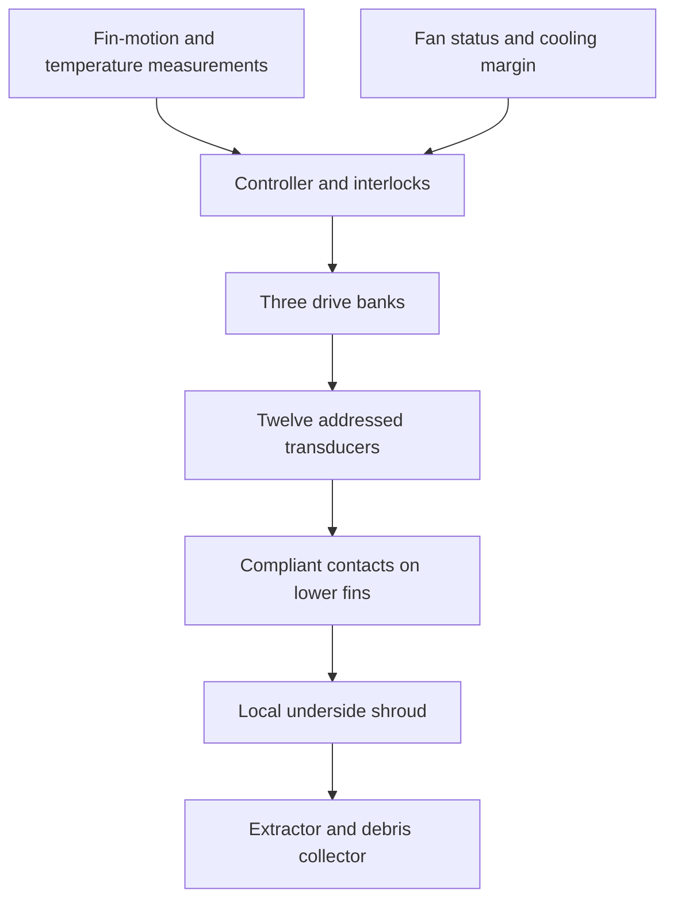
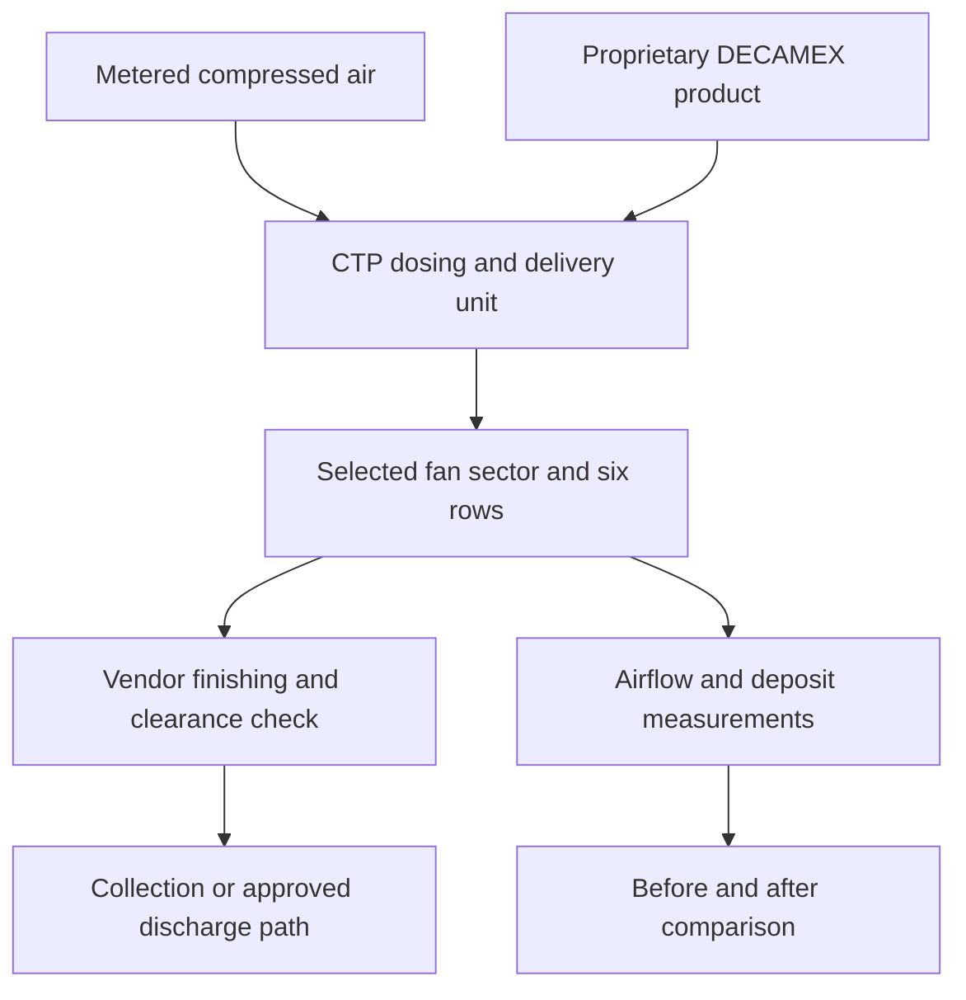

# A-1401 — Detailed preliminary engineering designs and quantitative protocols

**Revision 2 · corrected 14 November 2026 · Air Liquide AIChE Student Competition**

> Revision 2 corrects source citations, removes private links, and replaces the sensible-only thermal comparison with results from the project's wet (condensing) model. Thermal results: `a1401_clean_vs_fouled/` (model) and `a1401_solutions_check/simulate_solutions.py` (`SIMULATION_REPORT.md`). Every change is listed in `CHANGES.md`. Design, protocol and resource sections are unchanged except where marked.

## 1. Purpose, scope, and engineering status

This document specifies two selected concepts: (1) an Aculon AL-A/AL-B low-adhesion surface treatment with mechanically coupled piezoelectric vibration and active debris extraction; (2) CTP DECAMEX dry chemical cleaning. It supplies dimensions, quantities, chronological protocols, numerical effectiveness scenarios, and a thermal comparison on the project's wet model. Read together with `A1401_Solutions_Defense_Summary_corrected.md`.

**Requested exclusions:** Task Parts 6 and 7—the techno-economic register and formal hazard-input register—are intentionally omitted. Their four corresponding register sections in the requested output outline are also omitted. The physical quantities, operations, material identities, and engineering restrictions needed by those separate analyses remain in the design and protocols. No prices, payback, risk rankings, or completed HAZOP are supplied.

**Status:** a concrete preliminary design for evaluation, not a vendor offer, demonstrated A-1401 retrofit, or authorized operating procedure. Solution 2 is recommended for a near-term vendor trial. Solution 1 is an experimental alternative whose coating access, liquid inventory, and vibration coupling create substantial practical disadvantages. A pilot can invalidate it; it should not be presented as deployment-ready.

### Evidence labels

- **DOCUMENTED (D):** directly inspected Air Liquide drawing, passport, brief, or historian record.
- **RESEARCH/VENDOR (R):** a retrieved publication or manufacturer statement, with its original application and limitation.
- **PROPOSED (P):** our selected design, assumption, test acceptance criterion, or scenario; not a supplier specification.
- **CALCULATED (C):** computed from explicitly identified D/R/P inputs.
- **TBD:** not established. A proposed sensitivity can accompany a TBD value but does not turn it into a measurement.

### Source completeness and provenance

Equipment values were taken from the general drawing VP-3212-A-1401-0001, the bundle drawing VP-3212-A-1401-0010 and the vessel passport. The values that also appear in the project's audit (`AUDIT_report.md` §1) agree with it. Values that appear only in the bundle drawing (62 mm transverse pitch, 2,980 / 2,950 mm widths, 590 mm frame height, 10,592 mm envelope, 10,277 kg bundle mass) could not be re-checked in this project, because that drawing is not among the project files; they are marked **D\*** below.

The project's wet/condensing rating model is available: `a1401_clean_vs_fouled/` (current: 6 rows × 24 segments, two passes, wet syngas with condensation, fan/system curve; `REPORT.md`) and `model/` (earlier version). Revision 1 of this document used a separate sensible-only model (clean UA 13.95 kW/K, no condensation). That model is superseded: its UA comes from a dry-gas-only duty and underestimates the real UA about ninefold (`REPORT.md` §6.3). All thermal results below come from the wet model.

## 2. Verified equipment and operating basis

### 2.1 Source locations and design values

PDF page numbers below count pages in each retrieved PDF; scanned compilation page numbers are given where visible.

| Quantity | Value | Evidence and exact location | Design use |
|---|---:|---|---|
| Main bundle count | 1 | D: general drawing 0001, sheet 1, equipment list item 3 | One treatment envelope |
| Main tube count | 276 | D: vessel passport PDF p.5 / scanned p.92; bundle drawing 0010 bill of materials item 31 | Surface distribution |
| Tube OD / wall / length | 25 mm / 2 mm / 10,500 mm | D: passport PDF p.5 / scanned p.92, bottom tube entry | ID = 21 mm; treatment length |
| Tube material | 00Cr19Ni10 / S30403 | D: same passport entry; general drawing materials table | Process tube is stainless steel; not evidence of fin alloy |
| Rows / tube-side passes | 6 / II | D: bundle 0010, upper-right parameter table; section C–C shows two groups of three rows | Multi-row penetration |
| Transverse tube pitch | 62 mm | D\*: bundle 0010 section C–C, dimension `45.5 × 62 = 2821` | The wet model assumes 64 mm (assumption A12); 62 mm would make its face area about 3 % smaller. To be adopted at the next model revision. |
| Bundle overall width | 2,980 mm | D\*: bundle 0010 C–C, bottom dimension | Frame envelope |
| Header/body width used for projected treatment | 2,950 mm | D\*: bundle 0010 end view, `2950 ±2`; passport floating header width | Face-area approximation, not net free area |
| Overall side-frame height | 590 mm | D\*: bundle 0010 C–C right-hand dimension | Bath envelope; not six-row active fin depth |
| Bundle longitudinal envelope | 10,592 ±6 mm | D\*: bundle 0010 upper-left longitudinal view | Preliminary bath length |
| Bare reference area | 226 m² | D: general 0001 and bundle 0010 parameter tables | Reference heat-transfer area |
| Tabulated extended surface | 5,288.4 m² | D: same tables, fin/extended-area entry | Total external-surface accounting proxy |
| Bundle mass | 10,277 kg | D\*: general 0001 item 3; bundle 0010 parameter table (not in the project audit) | Removal/lifting scope |
| Fans | 3 × 2.4 m | D: general 0001 fan parameter table and plan view | Three sequential service sectors |
| Per-fan volume / speed / total pressure | 114,000 m³/h / 477 rpm / 190 Pa | D: general 0001 fan parameter table | Nominal clean-air reference; not a fan curve |
| Motors | 3 × 11 kW | D: general 0001 motor table | Connected motor rating, not measured consumption |
| Speed-control frequency range | 25–50 Hz | D: general 0001 motor table | Controller output cannot be equated directly to rpm |
| Working inlet pressure | 2.69 MPa(g) | D: general 0001 explicitly labels gauge pressure | Distinct from model absolute pressure |
| Design pressure / temperature | 4.0 MPa / 170°C | D: general 0001 and bundle 0010 parameter tables | Design context; not a new operating envelope |
| Nominal process temperatures | 135 / 55°C | D: same tables | Design-point consistency check of the wet model (`REPORT.md` §6.3) |
| Separate heating bank | One row; 21.3 m² bare / 498.4 m² extended; 200°C design | D: general 0001 lower heating-bank table | Excluded from both treatments and all quoted main-bundle area |
| Louvres | Manual | D: general 0001 lower table and item 5 | Record position in before/after testing |

**Area interpretation:** the translated drawings do not fully resolve whether 5,288.4 m² includes every exposed bare strip between fins. Use it as the total extended-surface proxy consistently; do **not** add 226 m² automatically. Neither number is the area of a spray/nozzle traverse. Fin alloy, thickness, diameter, pitch along the tube, attachment, corrosion, and repair condition are still TBD. Aluminum fins are a working hypothesis inherited from the handover, not independently verified metallurgy.

### 2.2 Calculated geometrical scope

Using 10.5 m tube length and 2.95 m treatment width:

- **C:** projected face = `10.5 × 2.95 = 30.975 m²`.
- **C:** three equal planning sectors = `30.975/3 = 10.325 m²` each; approximately 3.5 × 2.95 m. Real fan influence zones are not exact rectangles.
- **P/C:** four patches per fan sector = **12 patches**, each approximately 1.75 × 1.475 m = **2.581 m²**.
- **C:** average extended surface per row = `5288.4/6 = 881.4 m²`; per fan sector = 1,762.8 m²; per patch = 440.7 m² across all rows.
- **C:** gross tube exterior area = `276 π 0.025 ×10.5 = 227.61 m²`, about 0.7% above tabulated 226 m². Effective exposed length implied by 226 m² is about **10.43 m**. End lengths/rounding plausibly explain the difference; retain the tabulated reference area.
- **C:** all fan-disc areas total `3π(2.4²)/4 = 13.57 m²`. Fan-disc area, face area, free passage area, and extended surface are four different quantities.
- **C:** rated volume 342,000 m³/h = 95 m³/s; nominal superficial face speed on the planning rectangle = **3.07 m/s**.

The section drawing shows a gap between the two three-row groups. Do not replace the assembly with six uniformly spaced rows when planning deep-row access. Heating-bank, fan, louvre, and support clearances must be surveyed before access equipment is designed.

### 2.3 Operating records and limitations

| Record | Observed/reported values | Use and restriction |
|---|---|---|
| D: common hourly records 1 Jan 2026, 00:00–02:00 UTC | TIA050 mean 144.298°C; TICA0055 PV mean 69.680°C; controller output mean 53.853; FI010 mean 22,609.794; flare-controller output zero | These three rows are independently present in the supplied workbook. Only inlet and flow enter the default thermal comparison. It does not simulate the measured fan setting. |
| Reported PI Vision snapshot in user brief/diagnosis | 166.78°C inlet; 66.4°C outlet; 87.887 fan command; 20,801 Nm³/h FI010 | Screenshot itself is not in the current attachments; treated as supplied operating context, not a verified simultaneous clean benchmark. |
| D: hourly CSV | 20,176 rows; 14 Nov 2023–11 Mar 2026; incomplete early tags and shutdown conditions | A row count is not a usable-running-hour count. Do not infer a clean baseline from the whole file. |
| D: Excel-format `.crdownload` | 5,949 consecutive identical five-tag records, 11 Mar 2026 12:00 UTC–14 Nov 2026 08:00 UTC | Exclude the frozen segment; a final changed November record exists. Filename is unusual but ZIP integrity and spreadsheet structure are readable. |
| Wet model, `a1401_clean_vs_fouled` | Reference window 18 Jul 2025 (159.4 °C, 17,444 Nm³/h, air 31.8 °C, fans 100 %): clean duty 4,244 kW, 56 % condensation, outlet 36.7 °C, UA 106.5 kW/K (119 at the design point). End of summer 2025: equivalent blockage 0.685, duty 3,530 kW, outlet 75.2 °C. Equivalent blockage 0.53–0.69 on fans-100 % hours since 2024. | Model results checked against withheld historian weeks (MAE 2.4–3.5 K in three of four periods). The base of about 0.59 cannot be credited to removable debris. |
| Historian, equivalent blockage | Spring base 2025 0.594; seasonal increment +9 points (2025) and +12 points (2024), built from late April to late June; October 2025 cleaning 0.682 → 0.557 | Seasonal increment and its removal are measured; the base is not explained. |

FI010 is downstream of water separation and potentially a flare branch. It is a dry-gas proxy, not wet inlet mass flow. PICA0017 **MV** is valve/controller output, not pressure. A 65°C setpoint is not an established hard production constraint. The handover gives September 2025 as a cleaning date; the historian shows equivalent blockage still at 0.68 on 25 Sep and 1 Oct 2025 and at 0.58 on 30 Oct 2025, so the data place that cleaning in October 2025. These issues prevent a defensible annual production-benefit claim from the present calculations.

## 3. Solution 1 — Selected engineering design

### 3.1 Coating selection and alternatives

| Candidate | Evidence | Decision |
|---|---|---|
| **Aculon AL-B monolayer (AL-A pretreatment only if Aculon requires it for the fin metal)** | R1: thin repellent coating with disclosed thickness and degradation temperature; dip application; intended for "most metals" | **Selected experimental coating.** Very small thermal penalty; application/access burden explicitly included. Full-scale outdoor fin durability and fibre adhesion remain unproven. |
| Aculon Multi-Surface Oleophobic spray treatment | R7: sprayable 200–300 nm film; manufacturer explicitly limits long-term abrasion expectations; continuous temperature rating absent from retrieved TDS | Reject as primary because easy application does not resolve thermal-life and durability uncertainty. |
| Heresite P-413 baked phenolic epoxy | R8: established heat-exchanger corrosion coating, 25–50 µm by two-coat immersion on heat-transfer parts, vendor-stated heat-transfer loss < 1 % as applied, published adhesion and heat tests | Relevant corrosion alternative, but retrieved evidence does not establish reduced cottonwood adhesion. Baking and added film thickness also complicate this retrofit. |
| Research SiO₂/PFMA core-shell coating | R9: spray-coated aluminum coupons showed water/hexadecane angles 178.5°/159.2° and 5B cross-cut adhesion | Research alternative; no dry fibrous-fouling result or demonstrated A-1401 coating life. Added surface texture is not automatically advantageous against entanglement. |

The chosen product is a proprietary low-surface-energy monolayer, **not** an electrically active coating and **not** a disclosed silica/organosilane recipe. Its exact chemical composition requires the supplier's current SDS/technical declaration; do not substitute a guessed formulation.

### 3.2 Selected coating basis

**R1 data used:** AL-B thickness 2–4 nm; liquid density 0.98 kg/L; proprietary solids below 5%; ethanol/fluorosolvent carrier; water/oil contact angles 116°/80° on the supplier's flat substrate; degradation temperature 225°C. The TDS names "most metals, semiconductors, and certain polymers that have been pretreated with Aculon AL-A" as substrates: AL-A pretreatment is stated for polymers, not for metals. Whether aluminium fins need AL-A must be confirmed with Aculon. The TDS discourages spray application because the film is "autophobic" and specifies a one-minute dip (five minutes with sonication); curing guidance mentions 120 °C peak metal temperature. A continuous-service rating, UV/outdoor durability, quantified fin service life, dry density, thermal conductivity, and exact solids fraction are unavailable.

**P:** use **3 nm** for film calculations, dry density **1,500 kg/m³** and conductivity **0.2 W/(m·K)** only as sensitivity inputs. Check 2–4 nm, 1,200–2,000 kg/m³, and 0.1–0.3 W/(m·K). The quoted 225°C onset is not proof of years of performance at 170°C.

**Mechanism hypothesis:** lower surface adhesion and sliding friction may help vibration release dust, pollen and weakly attached insect fragments. A hydrophobic contact angle does not measure dry-particle adhesion. Mechanically interlocked cottonwood fibres can remain attached regardless of surface energy. No exterior condensation-driven self-washing is assumed on this hot air cooler.

### 3.3 Selected application and coverage

**P:** remove the main bundle during a planned outage and treat it in a shop using a full-length immersion enclosure. Do not spray AL-B through the installed six-row assembly or pretend that one exposed face equals all its area. Temporary closures and handling arrangements are developed for the bundle; no process-side coating is intended.

Target all six rows geometrically but credit **80% effective coated area** centrally, allowing for masked supports, inaccessible contacts, trapped air and defective patches. Low/base/high coverage is 60/80/100%. Witness coupons at top, middle and bottom rows are required to validate coverage. The heating bank, motors, fans, louvres, instruments and headers' sealing faces are outside the coating scope.

**Bath envelope P/C:** approximately **10.8 m ×3.2 m ×0.70 m = 24.192 m³ gross fill**, based on the verified 10.592 m length, 2.980 m frame width and 0.590 m frame height with handling allowance. This is an upper geometrical inventory proxy, not a vessel design. The actual fin elevation, nozzle masking, fixture clearance, metal displacement and liquid level must be resolved before ordering. No credit is taken for displacement in the resource base case. The bath has independent structural support; its liquid weight is not carried by the exchanger.

**Why full-length treatment:** sectional trays would encounter the actual supports and cannot be assumed to immerse complete fin rings in the installed assembly. The selected shop bath avoids inventing such access. It is nevertheless a major disadvantage, and a reason to limit this concept initially to a representative fin-section pilot. A large inventory is not justified merely because the deposited film is extremely thin.

### 3.4 Vibration, coupling, and debris exit

**P selected hardware:** twelve bolt-clamped piezoelectric/Langevin-type modules with **50 W maximum input per addressed channel for sizing**, twelve replaceable compliant coupling combs, and three four-channel drive banks—one bank per fan sector. Use one channel at a time in the resource case. No off-the-shelf transducer is claimed as qualified for the plant's electrical area or temperatures.

Each approximately 1.75 ×1.475 m patch has one coupling module attached to a small non-pressure support bracket. A compliant, rounded comb contacts selected lower-row fin rims. Static preload is carried by the bracket, not forced onto thin fins. The intended transmission path is actuator → short coupling bar → distributed compliant fin contacts → local fin motion. **A frame vibration signal alone does not demonstrate useful fin vibration.** Contact geometry, preload, amplitude, and fatigue limits are TBD. Do not drill or weld process tubes, headers, or pressure-retaining parts. Support bracket qualification still applies.

Direct fin contact is selected over frame-only excitation because the latter leaves an unknown transmission path through supports and tube/fin interfaces. It is selected over bonded patches on every individual fin because that would require impractical access and very large device counts. Its potential fin damage and limited coverage are the central unresolved engineering risks.

**R2 mechanism evidence:** a 570 ×540 mm inclined PV module used PZT-4 excitation near 28 kHz and recovered over 97% of short-circuit current at approximately 10 W (10.68 W measured). Recovery depended on tilt: 97.5 % at 30°, 98.5 % at 45°, 81 % at 15°; dust was sieved below 48 µm. Gravity provides the transport. A horizontal fin bundle with upward airflow has no comparable slope, and fine dust differs substantially from cottonwood. The experiment's voltage and frequency are not released plant settings.

**P qualification approach:** a low-energy 20–40 kHz modal/impedance survey identifies candidates; only frequencies meeting fin-response and stress limits can be retained. There is no prescribed plant amplitude. For a sinusoidal fin displacement, `a_peak=(2πf)²x_peak`; at 28 kHz, a purely illustrative 10 nm gives approximately 310 m/s². This is an explanatory calculation, not a target. Detachment additionally depends on adhesion, fibre entanglement, and repeated-contact damage.

**P cleaning cycle:** affected fan stopped and secured under a plant-defined window; other fan sectors only run if cooling and crossflow are acceptable. A movable extraction hood beneath the treated sector draws detached matter downward, away from the deeper rows, into a sealed collector. Use a **500 m³/h, 1.5 kW extraction package** only for resource sizing. Full-sector average capture velocity would be just `500/3600/10.325 = 0.0135 m/s`, so it must work through a **local shroud**, not an open full-bundle hood. A 0.10 m² active opening gives about **1.39 m/s** before leaks; capture must be demonstrated. Do not claim full-sector capture from this nominal flow.

Forces and airflow from adjacent fans can defeat downward capture. If a tracer test shows carryover into deeper rows or adjacent sectors, an all-fans-stopped outage/derated window is required. Nothing in the current data guarantees online cleaning. Removing material from the lowest row does not automatically remove material already lodged in the upper five rows.

### 3.5 Conceptual component arrangement

This is our functional concept, not an OEM drawing.

Coating precedes this arrangement: planned bundle removal → shop preparation → AL-B immersion (AL-A if required) → drying/inspection → reinstall bundle. It does not form part of the vibration electrical circuit.

## 4. Solution 1 — Chronological engineering protocol

All numerical acceptance values below are **P project criteria**, not standards or vendor guarantees. Steps describe an engineering proposal and test campaign, not live-plant operating instructions.

### S1-01 — Define the physical treatment boundary

**Purpose →** connect the proposal to actual surfaces. **Selected method/design →** mark three fan sectors and twelve inspection patches on drawings and photographs. **Inputs/equipment →** drawings 0001/0010, survey, borescope and fin samples. **Quantitative parameters →** 30.975 m² projected face, six rows, 5,288.4 m² surface proxy; inspect all twelve patches at three depth levels. **Expected output →** as-found area/access map and verified fin material. **Resources →** two staff ×4 h =8 person-hours, access equipment separately. **Verification →** compare dimensions and sample identification with the drawings. **Restriction →** no treatment of the separate heating bank; do not infer all-row cleanliness from the bottom face.

### S1-02 — Prepare representative coating specimens

**Purpose →** establish compatibility before committing to a large bath. **Method →** use spare/representative fin stock with the same alloy, oxide and corrosion condition; preserve actual fin geometry on section specimens. **Inputs →** AL-A, AL-B, current SDSs, approved cleaner, small immersion vessels and balance. **Parameters →** twelve 100×100 mm coupons, both sides exposed: 0.24 m² total; reserve roughly 1 L of each treatment for the coupon campaign. **Output →** coated/uncoated specimens and recorded batch/drying conditions. **Resources →** coating bench, microscopy and supplier-defined preparation chemistry. **Verification →** witness thickness/composition and adhesion/repellency before and after aging. **Restriction →** do not use strong etching or roughening on thin operating fins without material review; no product blending or guessed AL-A formulation.

### S1-03 — Test heat, aging, and coating penalty

**Purpose →** determine whether the chosen film survives relevant fin temperatures. **Method →** controlled chamber exposure of coupons, followed by actual-dust adhesion/release tests and a clean fin-section thermal test. **Inputs →** thermocouples, chamber, microscopy, contact-angle equipment, airflow bench. **Parameters →** screen actual measured fin temperatures; include 170°C exposure on suitable bench coupons and a proposed 100 h initial aging screen, with longer durability evaluation before life claims. **Output →** retained film performance and measured clean UA/pressure effect. **Resources →** 100 chamber-hours plus test labor; chamber electrical energy is measured, not guessed. **Verification →** P acceptance: clean thermal penalty ≤2%, no visible bridging/delamination, and lower debris-release force than controls. **Restriction →** short bench aging cannot establish annual coating life; 225°C degradation is not a continuous-temperature certificate.

### S1-04 — Qualify the actuator and coupling unit

**Purpose →** generate local fin motion without unacceptable damage. **Method →** one PZT module and compliant comb on a representative finned section; map motion using laser vibrometry, with bracket accelerometer and strain/temperature measurements. **Inputs →** impedance analyzer, current/power meter, fixture and structural model. **Parameters →** survey 20–40 kHz at low excitation; 50 W/channel is an electrical-sizing ceiling only; amplitude/preload approved after testing. **Output →** validated transfer map, allowable mode and motion, coupling detail. **Resources →** one prototype module plus fixture; two test staff ×8 h =16 person-hours planning allowance. **Verification →** stress/fatigue checks and no permanent fin deformation or loosened fin/tube attachment. **Restriction →** do not infer allowable settings from the PV paper; mounting cannot obstruct tube thermal expansion.

### S1-05 — Measure four cleaning mechanisms separately

**Purpose →** separate coating benefit from vibration and extraction. **Method →** compare uncoated/no vibration, coating only, vibration only, and coating+vibration at the same capture flow. **Inputs →** representative cottonwood, dust, pollen and insect fragments; weigh and photograph deposits. **Parameters →** three replicates per condition; test both initial 30% projected obstruction and realistic layered/interlocked deposits; include dry and damp/aged samples. **Output →** passage reopening, mass removal, redeposition and fin damage separately. **Resources →** twelve test runs plus clean baselines; one reusable multi-row section preferred. **Verification →** measure obstruction by images, pressure resistance at matched airflow, and collected versus retained mass. **Restriction →** a single flat coupon cannot validate six-row penetration; failing to outperform vibration-only means the coating adds no demonstrated cleaning benefit.

### S1-06 — Verify the debris exit path

**Purpose →** prevent transfer of blockage into deeper rows. **Method →** place tagged fibres upstream and inspect collection/deep rows after vibration plus extraction. **Inputs →** local shroud, 500 m³/h sizing extractor, collectors, borescope. **Parameters →** central exit fraction e=0.8 is a scenario to replace by measured data; map capture with adjacent fan influence reproduced where possible. **Output →** escape/redeposition fractions and extraction geometry. **Resources →** about 0.5 h extraction per full twelve-patch sequence in the resource case. **Verification →** weigh capture, inspect deeper rows and close the material balance with a stated residual. **Restriction →** unsuccessful downward capture requires a different operating window; do not raise fan speed to force debris through the bundle.

### S1-07 — Define shop application and bath inventories

**Purpose →** establish a buildable application scope after the tests pass. **Method →** remove and shop-dip the complete main bundle using a coating stage and, only if Aculon requires it, a separate AL-A pretreatment stage. **Inputs →** lifting plan for 10,277 kg bundle, compatible bath/enclosure, containment, reservoirs and masking. **Parameters →** gross bath proxy 24.192 m³ per stage; central target area 4,230.72 m²; AL-B 3 nm. **Output →** approved bath geometry and measured net filling quantity. **Resources →** one chemical inventory (two if an AL-A stage is required) and a proposed 2 kW circulation package, not an integrated ready-made supplier skid. **Verification →** dimensions, immersion level and witnesses at all depths. **Restriction →** lifting hardware, liquid loads, closures and solvent facilities require their own design; no claim that the current site has them. If this scope is unacceptable, the selected coating retrofit is not implementable as written.

### S1-08 — Apply, dry, and inspect the coating

**Purpose →** produce the selected passive surface. **Method →** clean the removed bundle, mask excluded areas, apply AL-B (preceded by AL-A only if Aculon requires it for the fin metal) using supplier-controlled immersion/drain/rinse/dry instructions. **Inputs →** selected products, compatible cleaners/rinses and calibrated material inventory. **Parameters →** use the manufacturer's one-minute AL-B dip as the coupon reference; actual bundle dwell, draining and drying must be qualified. Credit 60/80/100% coverage in scenario accounting. **Output →** film coverage map and retained-liquid/waste record. **Resources →** preparation and bath allowances in §5; rinse volume remains formula-based until supplier sequence is known. **Verification →** witness coupons at twelve patches and three depths; representative fin contact-angle/composition checks and inspection for trapped residue. **Restriction →** do not spray AL-B; masks must prevent process-side contamination and preserve sealing surfaces.

### S1-09 — Install and commission the twelve modules

**Purpose →** reproduce the qualified local coupling on the actual unit. **Method →** install twelve brackets/combs/transducers, three drive banks and twelve response/temperature measurement locations. **Inputs →** approved module drawings, cabling, controller and extraction connections. **Parameters →** four patches per fan sector; projected permanent blockage allowance 0.2% of open face, verified by geometry and airflow test. **Output →** installed response and baseline-pressure maps. **Resources →** four installers ×16 h =64 person-hours P allowance; electrical/support work included only if explicitly covered by that scope. **Verification →** correct mode at every patch, measured power and no unacceptable vibration propagation. **Restriction →** no pressure-boundary attachment modification; electrical equipment selection follows actual area classification, not the lab setup.

### S1-10 — Demonstrate recurring cleaning and monitor condition

**Purpose →** verify incremental benefit after new fouling, without crediting initial shop cleaning twice. **Method →** operate the proposed sequential cleaning cycle during an approved window; collect before/after data with stable process and air conditions. **Inputs →** actual rpm, louvre positions, air temperature, process tags, air-velocity map and debris samples. **Parameters →** resource case 2 min/module, 12 modules, one full sequence/day over a 120-day fouling season; activation frequency is a test assumption. **Output →** measured post-cleaning resistance/UA trend, updated clearance parameters and inspection interval. **Resources →** electrical/capture energy in §5; inspect monthly in the first season, retaining an annual coating-inspection allowance. **Verification →** acceptance requires net resistance reduction and no worsening in deeper rows; report whether the central 26% passage-reopening scenario was met. **Restriction →** alarm/interlock settings derive from plant limits; 65°C is not imposed as a production trip. Annual recoating is a sensitivity, not a demonstrated requirement or life expectancy.

## 5. Solution 1 — Geometry, materials, power and time

### 5.1 Film material, purchased liquid, and waste are different quantities

`A_coat = 5288.4 × f_coverage`

`V_dry = A_coat × thickness`; `m_dry = V_dry × rho_dry`.

| P scenario | Coverage | Thickness | Assumed dry density | C coated area | C dry film volume | C dry film mass |
|---|---:|---:|---:|---:|---:|---:|
| Low film requirement | 60% | 2 nm | 1,200 kg/m³ | 3,173.04 m² | 0.00635 L | 7.62 g |
| Central | 80% | 3 nm | 1,500 kg/m³ | 4,230.72 m² | 0.01269 L | 19.04 g |
| High film requirement | 100% | 4 nm | 2,000 kg/m³ | 5,288.40 m² | 0.02115 L | 42.31 g |

These small quantities describe only an ideal dry monolayer, not liters to purchase. For AL-A, dry-film thickness/mass are TBD; do not assume that its deposited quantity equals AL-B.

**P/C bulk requirement:** use 24,192 L initial gross working inventory for AL-B. A separate AL-A stage of the same inventory is needed only if Aculon requires AL-A for the fin metal (R1 states AL-A pretreatment for polymers only). The latter is an enclosure-sizing assumption, not AL-A consumption guidance. AL-B inventory mass at the published density is about **23,708 kg**. AL-A mass remains `24,192 × rho_ALA(kg/L)` until supplied.

| P campaign loss fraction of working inventory | C makeup per stage | C initial fill + makeup, per stage |
|---|---:|---:|
| 1% | 241.92 L | 24,433.92 L |
| 3% central | 725.76 L | 24,917.76 L |
| 5% | 1,209.60 L | 25,401.60 L |

Loss includes drag-out, unsuitable residual liquid and evaporation; measure their split. It is **not** all solid hazardous waste or all atmospheric release. Remaining usable liquid is recoverable inventory, not necessarily consumed. A supplier may provide/reclaim its bath inventory; a later economic analysis must distinguish that service arrangement from outright chemical purchase.

The published `<5%` ingredient value is an upper bound, not a known solids fraction. The conventional paint formula `V_liquid=V_dry/(solids×transfer efficiency)` is inappropriate for sizing this immersion operation. Required bath fill dominates. Rinse and preparation quantities are `Q_rinse × t_rinse × number_of_rinses` and `Q_clean × t_clean`; no vendor-approved values were found. For preliminary utility sensitivity only, allocate **0.5/1/2 m³** preparation/rinse liquid per campaign, then replace with an actual supplier method; it may be solvent rather than water depending on the stage.

### 5.2 Coating thermal and hydraulic penalties

Using central P values:

- Film resistance per coated surface area: `R'' = 3e−9/0.2 = 1.5e−8 m²·K/W`.
- For illustration, with air coefficient 49 W/m²K from the earlier diagnosis, local `hR'' ≈7.4e−7`; simple conduction penalty is negligible.
- A thin-coating area-average approximation adds `R_coat,total ≈ f_coverage t/(k A_ext) = 2.27e−12 K/W` to a lumped model. This is **not** resistance divided by bare-tube area.
- If the earlier assumed 2 mm fin gap were correct, `2t/gap =3e−6`, or **0.0003%** gap reduction. That gap is unverified. Actual residue bridging, poor preparation and coating defects can dominate this tiny ideal-film result.
- Permanent hardware is more significant: P obstruction fraction **0.002** centrally, sensitivity **0–0.01**. On 30.975 m² face, 0.002 corresponds to about **0.062 m²** projected obstruction. CAD and clean-air tests must verify this allowance.

Thin-film calculations omit contact resistance, altered fin-to-tube attachment and chemical damage. These must be tested; a negligible calculated conduction penalty alone cannot establish unchanged thermal performance.

### 5.3 Hardware, electricity, duration and maintenance quantities

**P full-scale count:** 12 actuators +12 comb/bracket sets +3 four-channel drive banks +1 controller +12 local response/temperature measurement locations +1 movable shroud/extraction collector. Add one laboratory development module separately; do not count it as an installed spare unless transferred after qualification. Budget **two spare transducer/comb sets** as a proposed maintenance stock, with no established annual replacement rate.

For one full sequence:

- Actuation: `12 ×0.050 kW ×2/60 h = 0.020 kWh` electrical input. At most one channel active in the resource case; 0.60 kW is the sum of all channel nameplates, not normal simultaneous demand.
- Extraction: `1.5 kW ×0.5 h =0.75 kWh`.
- Controller standby: `0.020 kW ×24 h =0.48 kWh/day`.
- Daily sequence total including standby: **1.25 kWh/day**; **150 kWh for a 120-day season**. If standby continues throughout the year, add 245×0.48 =**117.6 kWh**, totaling **267.6 kWh/year** under this assumed schedule.
- Low/high actuation-duration sensitivity 0.5–5 min/channel gives **0.005–0.050 kWh/sequence**; capture energy still dominates.
- Capture volume: **250 m³/sequence** at 500 m³/h for 0.5 h. Collector size depends on measured seasonal debris mass.
- Three sector windows of roughly **10 min each** are assumed for service scheduling; this does not mean a 30-minute total plant shutdown. Adequacy of temporary cooling is unverified.

**P shop planning allowances:** lifting/transfer 8 h, cleaning 8 h, drying 12 h, bath handling/drain operations 4 h, subsequent drying/inspection hold 12 h, actuator installation 16 h, commissioning 8 h: **68 h sequential elapsed allowance**, approximately 3–5 calendar days with work-window constraints. Drying times are planning placeholders, not solvent-clearance acceptance limits. Coating preparation personnel are provisionally three people for 20 active hours =60 person-hours; lifting crews and qualified inspection staffing are separately determined. Bath circulation at 2 kW for 8 h =16 kWh; crane, drying/ventilation and shop utilities need equipment-specific power/time and are not included in the 16 kWh.

No coating lifetime or transducer replacement frequency is established. Inspect monthly during the first season, then revise from observed coverage, contact wear, and response drift. Simulate annual requalification and 1/2/3-year recoating intervals as separate sensitivities if needed; each recoating repeats the major outage/application burden. No fixed useful life is asserted.

## 6. Shared debris-clearance model and Solution 1 scenarios

This is a model of **effective blocked passage fraction**, not a particle-resolved simulation. Blockage remains fixed during each steady-state thermal calculation, as requested.

Define:

- `b0`: initial equivalent blockage. Revision 2 default: the fitted plant state at the end of summer 2025, **0.685**, of which **0.594** is the spring base and **0.091** the seasonal increment (historian, wet model). The clearance acts on the seasonal increment only (§6.3). 0.30 is kept only as a labelled example; on the wet model it raises the reference-day outlet by just 4.4 K over clean.
- `c`: fraction of the initial obstruction that the treatment reaches effectively, weighted by its hydraulic importance.
- `d`: fraction of that reached obstruction locally detached/released.
- `e`: fraction of detached obstruction that escapes without creating replacement obstruction elsewhere.
- `eta_open = c d e`: net fraction of the initially blocked passage contribution reopened.
- `b_post_debris = b_base + (b0 − b_base)(1−eta_open)` (revision 2: clearance acts on the seasonal increment only, §6.3).
- `b_effective = b_post_debris + (1−b_post_debris) b_hardware`.

`c` is **not** the fraction of all fin area coated. A high `c` for lower-row vibration assumes most hydraulically important debris lies near the inlet face; it must be measured. A deeper fouling distribution lowers `c`, even if all rows are coated. `e` compresses redeposition into one scalar; if detached material becomes a worse obstruction, use an explicit redeposition term and allow net deterioration.

### 6.1 Hypothetical clearance inputs

| Solution 1 case, all P | c | d | e | C net reopening eta, one event | C blockage after one event on 0.685 (base 0.594), with 0.002 hardware | C blockage held Jul–Sep with daily cycles (season simulation) |
|---|---:|---:|---:|---:|---:|---:|
| Conservative | 0.40 | 0.25 | 0.50 | 0.0500 | 0.681 | 0.651 |
| Central illustrative | 0.65 | 0.50 | 0.80 | 0.2600 | 0.662 | 0.627 |
| Optimistic | 0.80 | 0.70 | 0.90 | 0.5040 | 0.640 | 0.613 |

Revision 1 applied these values to a hypothetical b0 = 0.30 (results 0.286 / 0.224 / 0.151); that basis is withdrawn (§6.3, §10).

These are a transparent sensitivity envelope, not confidence limits or literature-derived A-1401 probabilities. R2 supports vibration-induced release and the importance of transport, not these numerical efficiencies. Keep a **zero-clearance failure case**: with hardware obstruction the cooler can become slightly worse than the initial state. Do not claim that coating alone instantly removes deposits.

### 6.2 Metrics that must remain separate

| Metric | Definition | Measurement/model input |
|---|---|---|
| Debris mass removed | `(M_before−M_after)/M_before` | Weigh retained, captured and escaped solids; water correction |
| Passage reopening | `(b_before−b_after)/b_before` | Comparable obstruction images or a validated hydraulic inverse model |
| Excess resistance removal | `(K_before−K_after)/(K_before−K_clean)` | Fit K at matched airflow: pressure drop = K×flow^n |
| Airflow gain | `V_after/V_before−1` | Full-face velocity integration at matched fan rpm, louvres, density |
| UA gain | `UA_after/UA_before−1` | Common process enthalpy model and air measurements |
| Duty gain | `Q_after/Q_before−1` | Same inlet/load/weather/controller conditions |
| Duty deficit recovered | `(Q_after−Q_before)/(Q_clean−Q_before)` | Explicit clean reference; not the same denominator as duty gain |

Mass, obstruction and resistance are not interchangeable. A small mat can block many passages, while large insect pieces may contribute considerable mass but little blockage.

### 6.3 Long-term simulation and the historical baseline offset

A coating may also reduce new deposition. For now set the coating sticking multiplier **s=1.0** (no credited prevention benefit). Optional sensitivities **s=0.8 and 0.6 P** may be tested but are not evidenced. Between cleaning events a simple recursion is:

`b_before_next = min(b_max, b_after_previous + s g Δt)`

where `g` is a fitted growth rate under comparable load/weather, not yet known. Do not derive a numerical g from the earlier blockage trend without the missing model and treatment dates. Report cleaning efficacy and deposition suppression separately to avoid double counting.

The historical indicator contains a large persistent base. Revision 2 uses the measured values: **b_base = 0.594** (spring 2025) and **b_total = 0.685** (end of summer 2025). Treatment acts only on the removable increment:

`b_after = b_base + (b_total−b_base)(1−eta_open)`.

One event on the end-of-summer state then gives: S1 central **0.662**, S2 central **0.622**. The existing October 2025 cleaning took the indicator from 0.682 to 0.557, i.e. it removed at least the whole increment (eta ≥ 1 on this basis). Do not apply 26% or 68.85% removal to the entire indicator and credit removal of model bias/louvre effects.

For repeated events (S1 daily, S2 campaigns), the simulation uses a two-pool form: new deposit splits into a reachable pool (c) and an unreachable pool (1−c), and each event removes the fraction d·e of the reachable pool. This keeps the benefit of frequent cleaning capped by c. Results: `SIMULATION_REPORT.md`.

## 7. Solution 2 — Selected DECAMEX engineering design

### 7.1 What the service is and what the evidence establishes

Select **CTP environnement's DECAMEX proprietary dry chemical cleaning service**. R5 describes projection of a proprietary product for air-side treatment. R6 describes application from below followed, when needed, by an air finishing step. Product-assisted cleaning and pneumatic delivery/removal are involved, but the public sources do not establish a quantitative chemical-versus-mechanical contribution. Do not invent powder chemistry, particle size, dissolution reactions, hardness, nozzle pressure or dose.

CTP presents the process as low-pressure and compatible with finned equipment. These are vendor claims requiring project-specific confirmation for A-1401's actual fin material, condition, existing treatments and contaminants. It differs from water washing by avoiding the wash-water stream, and from generic abrasive blasting by its proprietary product and supplier-controlled technique. We do not assume any arbitrary abrasive can substitute.

**Industrial evidence:**

| Source | Documented/vendor result | Relevance and limitation |
|---|---|---|
| R3, Thailand cogeneration plant | Airflow +63% DECAMEX versus +14% baking soda under matched test settings; service completed in less than one day | Mineral/limestone deposits following hard-water washing. No transferable cottonwood removal fraction, dose or bundle area disclosed. |
| R4, Malaysian LNG maintenance | 336-bundle service population; up to four bundles/day; one fan stopped at a time for forced-draft units | Direct operational precedent, but not a guarantee of A-1401 duration or available cooling margin. |
| R6, French steelworks oil air coolers | Vendor reports performance gains above 15% relative to conventional cleaning, with airspeed checks | Dusty service; metric wording does not establish 15% additional total duty or a controlled organic-fibre efficiency. |
| R5, process FAQ | Multi-row treatment capability claimed | Supports proposing all-six-row scope; does not verify reach through A-1401's two three-row groups or winter-bank obstructions. |

No retrieved official case quantifies cottonwood, interlocked fibres, or insect-mat clearance specifically. The service may be effective but that must be demonstrated on representative material or one actual sector. Product composition/SDS, true bulk density, consumption, pressure and nozzle settings remain supplier inputs.

### 7.2 Selected scope and arrangement

**P:** one full main bundle campaign covering **30.975 m² projected face** and seeking all-six-row penetration. Execute in **three sectors**, matching the three fans, with **four inspection patches per sector**. The **5,288.4 m²** figure defines internal finned-surface extent, not the area used for the assumed nozzle-traverse dose. The separate 498.4 m² extended-surface heating bank is excluded; it may nevertheless obstruct access and must appear on the survey.

**P equipment package:** one vendor dosing/feed unit, one approved lance/nozzle set, one regulated compressed-air connection or rental compressor, air conditioning/separation as specified by CTP, hoses, metering/weighing equipment, and local boundary/debris monitoring. Delivery flow and powder feed are controlled by the vendor. No permanent plant retrofit is included.

**Fan arrangement:** one sector fan stopped at a time is the planning basis from R4. The other fans running does not guarantee the third sector is aerodynamically isolated. CTP must define actual access, crossflow, powder passage and finishing method. No entry into an operating fan sweep or unapproved plenum work is assumed.

**Debris path:** vendor-controlled application/airflow carries detached particles from gaps toward a verified discharge route. Inspect the downstream three-row group, louvres and nearby equipment for redeposition. The preferred A-1401 campaign includes removable ground/nearby-equipment protection and capture wherever feasible without restricting cooling. Do not fit a fine screen across the full running exhaust and assume it has zero pressure penalty. If extraction/containment changes flow, re-establish the fan operating point.

**Residues:** a dry process avoids washing effluent, but detached debris and product still exist. Biodegradability is not a mass-balance sink and does not independently establish permission to disperse contaminated material. The final capture/dispersal method depends on the SDS, deposit analysis, wind/access conditions and site requirements, to be addressed in the separate assessment.

## 8. Solution 2 — Chronological engineering and vendor-execution specification

### S2-01 — Record as-found geometry and fouling

**Purpose →** define a genuine all-row scope. **Selected equipment/service →** joint survey using drawings, photographs and borescope. **Required inputs →** fin material, weather, last cleaning records, access and heating-bank position. **Quantitative resource basis →** twelve face patches ×three depth checks; two survey staff ×4 h =8 person-hours P. **Intended outcome →** annotated fouling/access map with organic versus mineral/oily deposits identified. **Verification →** retained samples and consistent inspection locations. **Cost variables →** survey labor and access equipment only. **Hazards/approval dependencies →** site access and sample collection procedures; no unscheduled fan/plenum entry. This step can be specified now; actual samples are missing.

### S2-02 — Obtain the specific service definition

**Purpose →** replace hypothetical resources with supplier values. **Service →** CTP DECAMEX offer for A-1401, not generic blasting. **Inputs →** 276 tubes, six rows, 30.975 m² projected envelope, 2.98 m frame width, three forced-draft fans and excluded heating bank. **Quantitative basis →** require product kg, FAD air volume/rate, total campaign hours, per-fan stoppage and number of passes for the stated scope. **Outcome →** supplier operating envelope, SDS, waste method and scope exclusions. **Verification →** document which quantities cover application versus finishing and mobilization. **Cost variables →** service scope, mobilization, utilities included/excluded. **Dependencies →** metallurgy, organic-deposit suitability, operating/access approval. Scenario calculations in §9 can proceed before the offer; execution cannot.

### S2-03 — Set sector sequence and equipment configuration

**Purpose →** preserve access and cooling margin. **Service →** three sequential vendor-defined fan-sector interventions with twelve inspection patches. **Inputs →** fan layout, weather/load forecast, downstream cooling margin and supplier connections. **Basis →** three equal 10.325 m² planning sectors; low/base/high application time per sector in §9. **Outcome →** approved intervention order and allowable state of each fan. **Verification →** check crossflow and whether deeper rows can be reached. **Cost variables →** access, hoses, compressor occupation and temporary restrictions. **Dependencies →** actual fan isolation/access arrangements and plant operating limits; equal sectors do not prove equal cooling contribution.

### S2-04 — Establish comparable pre-cleaning measurements

**Purpose →** measure improvement separately from weather/load change. **Service →** synchronized process and air-side survey. **Inputs →** actual fan rpm/current, louvre positions, TIA050, outlet PV, FI010, flare indication, air inlet temperatures and measured air-velocity grid. **Basis →** P: at least 30 min stable averages and 12 patches with multiple velocity points per patch; record minimum/maximum variation rather than claiming steady operation. **Outcome →** before-treatment performance map and measurement uncertainties. **Verification →** confirm timestamp basis, exclude frozen records and do not convert controller command directly to airflow. **Cost variables →** instruments and staff hours. **Dependencies →** safe measurement locations and approved plant test window. No clean baseline is assumed.

### S2-05 — Execute the vendor-controlled treatment

**Purpose →** release organic obstruction across all rows. **Service →** DECAMEX product application with qualified delivery unit and, if needed, final air blow. **Inputs →** approved method, weighed product inventory, metered air and monitored plant state. **Basis →** central resource allowance 46.46 kg product, 3.87 application hours, 1,452 FAD m³ total air including finishing; not operating specifications. **Outcome →** treated sector and actual consumption/time log. **Verification →** inspect each patch/depth before accepting the sector; record inaccessible areas and rework. **Cost variables →** product, air, compressor and labor quantities only if not already bundled in the quote. **Dependencies →** nozzle pressure, stand-off, product feed, exact fan state and personnel method remain CTP/Air Liquide controlled. No numerical pressure instruction is prescribed here.

### S2-06 — Account for debris and product

**Purpose →** identify removed versus relocated material. **Service →** weighing, collection, discharge observation and downstream inspection. **Inputs →** product balance, deposit samples, local collection arrangements. **Basis →** use the material balance in §9.3; mass measurement does not substitute for passage inspection. **Outcome →** collected, retained, recovered-product and unaccounted fractions with uncertainties. **Verification →** inspect deeper rows and louvres for accumulations after treatment. **Cost variables →** containers, collection and disposal quantities supplied to the separate assessment. **Dependencies →** approved residue classification and discharge route; no automatic zero-waste claim.

### S2-07 — Inspect integrity and thermal/airflow recovery

**Purpose →** accept physical condition and quantify benefit. **Service →** repeat the same air/process survey and fin inspection after restart/stabilization. **Inputs →** pre-clean locations, actual rpm, weather and process measurements. **Basis →** P success: net hydraulic-resistance reduction exceeding measurement uncertainty, no increased deep-row obstruction, no unacceptable fin/tube damage. Compare measured clearance against central eta=0.6885 without treating it as a contractual guarantee. **Outcome →** measured gains and recalculated model input b. **Verification →** matched-condition comparison or a documented normalized model, plus instrument uncertainty. **Cost variables →** inspection and any agreed rework. **Dependencies →** allowable material condition and plant limits set by responsible engineers, not this report.

### S2-08 — Establish the repeat interval

**Purpose →** avoid fixed-frequency cleaning without evidence. **Service →** monitor normalized resistance and fan reserve after the first campaign. **Inputs →** history, actual cleaning date, fouling samples and seasonal exposure. **Basis →** P annual service scenarios **1 / 2 / 4 campaigns**, central pre-season plus mid-season. **Outcome →** measured interval versus modeled clearance/growth; replace assumed schedule when trends exist. **Verification →** compare same louvre/fan operating regime and exclude shutdown/frozen periods. **Cost variables →** campaign count, mobilization and consumables. **Dependencies →** plant review of intervention triggers; no arbitrary 65°C shutdown rule.

## 9. Solution 2 — Numerical resources and treatment effectiveness

### 9.1 Low/base/high resource scenarios

These are **P sensitivity assumptions**, not measured DECAMEX quantities. Resource-low/high labels do not correspond to conservative/optimistic cleaning effectiveness; consumption and efficacy must be varied independently. The industrial cases support service plausibility, not the following per-area dose or utility values.

Use projected face **A_face=30.975 m²**. Proposed powder allowance per campaign is 0.5/1.5/3.0 kg per m² projected face. Proposed single-pass productivity is 12/8/4 m² projected face per application hour. These are broad trial-sizing axes; no A-1401 vendor rate is available.

`m_product = A_face dose`

`t_application = A_face/productivity`

`V_air,FAD = 60 q_air,FAD t_application (1+f_finishing)`; use `f_finishing=0.25 P`.

`E_compressor = V_air,FAD e_specific`.

| Quantity | Resource-low P/C | Central P/C | Resource-high P/C |
|---|---:|---:|---:|
| Dose, kg/m² projected face P | 0.5 | 1.5 | 3.0 |
| Product, kg C | 15.49 | 46.46 | 92.93 |
| Productivity, m²/h P | 12 | 8 | 4 |
| Application time, h C | 2.58 | 3.87 | 7.74 |
| Free-air supply rate, m³/min P | 3 | 5 | 8 |
| Finishing air/time multiplier P | 1.25 | 1.25 | 1.25 |
| Total free-air volume, m³ C | 580.8 | 1,452.0 | 4,646.3 |
| Specific compressor energy, kWh/FAD m³ P | 0.08 | 0.10 | 0.12 |
| Compressor energy equivalent, kWh C | 46.5 | 145.2 | 557.6 |
| Preparation + measurements allowance, h P | 4 | 4 | 4 |
| Minimum occupied duration including finishing, h C | 7.23 | 8.84 | 13.68 |
| Personnel P | 3 | 3 | 4 |
| Person-hours for that occupied duration C | 21.68 | 26.52 | 54.72 |
| Application + finish per fan-sector, h C | 1.08 | 1.61 | 3.23 |

**Duration correction:** occupied duration is `4 +1.25 t_application`, so finishing is included in time as well as air. Preparation/measurement hours are an aggregate allowance; mobilization travel, procurement lead time and permits are outside these values. Extra deep-row passes multiply application time, dose and finishing requirements; use an explicit pass multiplier rather than assuming they are free.

FAD is free air at the compressor rating reference. It is not necessarily Nm³ at 0°C. The compressor energy factors are assumed package-level sensitivities, not a claimed air pressure. Central air rate and energy imply about `5×60×0.10=30 kW` during delivery. If site air or a diesel compressor is used, replace the electrical factor with the actual utility basis; do not charge both a complete rental service and a duplicate compressor purchase/energy line.

**Bulk powder volume:** the real product bulk density is TBD. Use `V_bulk(L)=m_product(kg)/rho_bulk(kg/L)`. At central 46.46 kg, hypothetical densities 0.4/0.7/1.0 kg/L give **116.2/66.4/46.5 L**. These are storage sensitivity examples, not DECAMEX density data.

### 9.2 Efficacy scenarios and model inputs

| Solution 2 case, all P | c | d | e | C net passage reopening, one campaign | C blockage after one campaign on 0.685 (base 0.594) | C blockage held Jul–Sep, campaigns 1 Jun + 1 Jul (season simulation) |
|---|---:|---:|---:|---:|---:|---:|
| Conservative | 0.70 | 0.60 | 0.75 | 0.3150 | 0.656 | 0.651 |
| Central illustrative | 0.90 | 0.85 | 0.90 | 0.6885 | 0.622 | 0.617 |
| Optimistic | 1.00 | 0.95 | 0.98 | 0.9310 | 0.600 | 0.599 |

Measured anchor: the existing October 2025 cleaning took the indicator from 0.682 to 0.557, i.e. eta ≥ 1 on the seasonal increment. The central DECAMEX assumption is therefore below what the plant's existing cleaning already achieved per event. Revision 1 applied these values to b0 = 0.30 (0.206 / 0.093 / 0.021); that basis is withdrawn.

All-six-row targeting supports testing higher reach than the lower-row vibration arrangement. It does not establish these numerical values. `d` is especially uncertain for interlocked cottonwood. `e` accounts for incompletely cleared/redeposited particles. No permanent new hardware remains across the face in the selected service, so the comparison uses `b_hardware=0`; any actual retained powder or new blockage must increase b or add film resistance.

An untreated failure case `eta=0` remains necessary. If test data show fibres collect deeper in the pack, add `b_redeposited` explicitly and allow `b_post > b0`. High-dose/high-consumption does not imply high cleaning efficiency.

### 9.3 Waste, residuals and repeated campaigns

For a non-reactive bookkeeping approximation:

`M_product + M_deposit_before = M_collected + M_retained_after + M_discharged + M_unaccounted`.

If the actual chemistry changes mass through reaction or volatilization, add the appropriate terms using vendor information. Do not assume such reactions from the name “chemical cleaning.”

Initial dry-debris loading is not measured. A **0.05/0.20/0.50 kg per m² face P** sampling-container sensitivity corresponds to **1.55/6.20/15.49 kg** initial debris. It is **not** inferred from 30% blockage. As a container-sizing example only: central 46.46 kg product +6.20 kg initial debris, 80% debris-mass removal and 70% capture of introduced product plus removed debris would yield about **36.0 kg collected solids**. The 80% mass removal and 70% capture assumptions are independent of eta_open; replace them with weighing. Uncollected material must be assigned to observed retained/discharged streams, not called eliminated.

At two identical central campaigns/year, arithmetic totals are **92.93 kg product**, **2,903.9 FAD m³**, **290.4 kWh compressor equivalent**, and **53.0 person-hours** using the corrected occupied duration. No annual extra production is claimed. Campaign efficiency may vary with moisture, deposit composition and age.

### 9.4 Temporary cooling during a fan stoppage

With equal independent sectors and no recirculation, stopping one of three fans removes roughly one third of nominal fan contribution: `342,000×2/3=228,000 m³/h` before fouling. This is only a screening assumption. It is not a 33% production loss and does not account for crossflow, louvres, natural draft or unequal sectors.

Wet-model screening (`a1401_solutions_check/results/one_fan_stopped.csv`): each running fan sees the same per-fan system curve, so total air is 2/3 of the three-fan value and one third of the face carries no air, `b' = 1 − (2/3)(1 − b)`. Natural draft through the idle sector is neglected, so this is an upper estimate of the penalty.

| Air, °C | Bundle state | Outlet, 3 → 2 fans, °C | Duty, 3 → 2 fans, kW | Max gas at 65 °C, 3 → 2 fans, Nm³/h |
|---|---|---|---|---|
| 20.0 | Spring base (0.594) | 45.0 → 76.3 | 4,103 → 3,505 | 22,190 → 15,500 |
| 20.0 | End of summer (0.685) | 61.0 → 95.1 | 3,814 → 3,062 | 18,220 → 12,630 |
| 31.8 | Spring base (0.594) | 59.4 → 89.2 | 3,843 → 3,212 | 18,770 → 13,130 |
| 31.8 | End of summer (0.685) | 75.2 → 105.1 | 3,530 → 2,780 | 15,430 → 10,710 |

Reference inlet 159.4 °C and 17,444 Nm³/h. These are screening results, not an allowable operating condition. Stopping one fan costs about 30 K at constant flow, or about 30 % of gas capacity at a 65 °C outlet; a campaign should be timed for a cool window or a planned load reduction.

## 10. Common thermal model — wet-model results

### 10.1 Model

Thermal results use the project's wet rating model `a1401_clean_vs_fouled/a1401sim` without modification: 6 rows × 24 segments, two tube passes (counter-crossflow), wet syngas with water condensation (W = 0.555 mol/mol dry, IAPWS-95 water, CoolProp ideal-gas dry gas), Gnielinski + Silver–Bell–Ghaly tube side, Briggs & Young air side with Schmidt fin efficiency, generic axial fan curve intersected with a Robinson–Briggs bundle resistance. Blockage b closes a fraction of the air passages: airflow follows the fan/system intersection, the active area is (1 − b)A, and h is evaluated at the local velocity in the open passages. Full basis and checks: `a1401_clean_vs_fouled/REPORT.md` §2–§7. The solution simulation is `a1401_solutions_check/simulate_solutions.py`.

The revision-1 sensible-only comparison (clean UA 13.95 kW/K, 800 kW clean duty, airflow ∝ (1 − b), b0 = 0.30) is withdrawn. Its central "5.0 % / 12.2 % sensible duty gains" do not describe A-1401.

### 10.2 Basis

| Input | Value | Category |
|---|---|---|
| Reference window | 18 Jul 2025, 17–20 UTC: inlet 159.4 °C, 17,444 Nm³/h dry gas, air 31.8 °C, fans 100 %, measured outlet 72.9 °C | D (historian) |
| Plant state, end of summer 2025 | b = 0.685 (fitted on calibration weeks) | C |
| Spring base 2025 | b = 0.594 | C |
| Clearance c, d, e | §6.1, §9.2 | P |
| S1 schedule / hardware | Daily, 1 May – 30 Sep; 0.2 % of open face | P |
| S2 schedule | Central 1 Jun + 1 Jul; sensitivity 1 and 4 campaigns | P |

### 10.3 Results at the reference window (bundle state held during July–September)

| State | b | Airflow, m³/h | UA, kW/K | Duty, kW | Sensible / latent, kW | Outlet, °C | Max gas at 65 °C, Nm³/h | Duty gain vs no action |
|---|---:|---:|---:|---:|---:|---:|---:|---:|
| No action (end of summer 2025) | 0.685 | 153,400 | 62.5 | 3,530 | 1,261 / 2,269 | 75.2 | 15,430 | — |
| S1 conservative | 0.651 | 167,900 | 66.6 | 3,672 | 1,369 / 2,303 | 68.3 | 16,750 | +142 kW |
| S1 central | 0.627 | 177,400 | 69.1 | 3,751 | 1,433 / 2,319 | 64.2 | 17,620 | +221 kW (+6.3 %) |
| S1 optimistic | 0.613 | 182,900 | 70.6 | 3,792 | 1,466 / 2,326 | 62.1 | 18,110 | +262 kW |
| S2 conservative | 0.651 | 167,800 | 66.6 | 3,671 | 1,369 / 2,302 | 68.3 | 16,740 | +141 kW |
| S2 central | 0.617 | 181,300 | 70.2 | 3,781 | 1,457 / 2,324 | 62.7 | 17,970 | +251 kW (+7.1 %) |
| S2 optimistic | 0.599 | 188,500 | 72.0 | 3,830 | 1,498 / 2,333 | 60.1 | 18,600 | +301 kW |
| Existing-type cleaning moved to 1 Jul | 0.595 | 190,000 | 72.4 | 3,840 | 1,506 / 2,334 | 59.6 | 18,730 | +310 kW (+8.8 %) |
| Best measured after a cleaning (Nov 2025) | 0.557 | 204,300 | 76.0 | 3,923 | 1,577 / 2,347 | 55.1 | 20,000 | +394 kW |
| Clean bundle | 0 | 342,000 | 106.5 | 4,244 | 1,865 / 2,380 | 36.7 | 32,110 | +714 kW |

Central recovery of the seasonal duty loss (313 kW): S1 71 %, S2 80 %. Of the loss against a clean bundle (714 kW): S1 31 %, S2 35 %. Capacity gain at a 65 °C outlet: S1 +14 %, S2 +16 %.

Season 2025 (2,863 historian hours, 1 Apr – 30 Sep, fans 100 %, air ≥ 10 °C): hours with outlet above 65 °C are 2,651 with no action, 1,589 with S1 central, 1,560 with S2 central, 1,530 with an existing-type cleaning on 1 Jul, and 1,032 if no seasonal debris formed at all.

**Labelled example only — the revision-1 30 % case on the wet model:** 30 % → outlet 41.1 °C, 4,170 kW; S1 central from 30 % → 39.5 °C, 4,198 kW (+0.7 %); S2 central from 30 % → 37.6 °C, 4,230 kW (+1.4 %). At 30 % blockage the exchanger has enough reserve that cleaning changes little.

At the central assumed efficacies, the difference between S1 and S2 follows from the assigned clearance parameters. Under equal net reopening and equal additional obstruction the model predicts equal performance.

### 10.4 Checks

Energy balance (process vs air side) closes to < 10⁻¹² % in every state; outlet rises monotonically with b; on the smoothed 2025 no-action path, the model reproduces the measured outlet with MAE 2.7 K and bias +0.8 K over 2,863 hours. The checks do not test the clearance assumptions, which have no A-1401 field data.

### 10.5 Area basis

Report post-treatment U with its area basis: `U_bare=UA/226` or `U_extended=UA/5288.4`. Comparing U values on different bases creates a factor of about 23.4 error.

## 11. Consolidated machine-readable handoff

This JSON is sufficient to reconstruct the completed comparison and carry the physical scenarios into another model. Units are explicit; null values are genuine missing inputs. Procurement quantities and efficacy are independent scenario axes.

Revision 2 replaces the revision-1 JSON and Python reproduction, which encoded the withdrawn sensible-only model. The machine-readable inputs are now:

- clearance and schedule parameters: `a1401_solutions_check/simulate_solutions.py` (constants `S1`, `S2`, `S1_HARDWARE`, `S1_SEASON`, `S2_SCHEDULES`);
- wet-model inputs: `a1401_clean_vs_fouled/a1401sim/config.py` (every value tagged with its source);
- results: `a1401_solutions_check/results/results.json`, `reference_day_states.csv`, `season_2025_scenarios.csv`, `one_fan_stopped.csv`.

The physical design quantities of §2–§9 (geometry, coating, actuators, DECAMEX resources) are unchanged and listed in the tables of those sections.

## 12. Side-by-side technical judgment

| Question | Coating + piezoelectric vibration | DECAMEX |
|---|---|---|
| Selected intervention | Permanent passive film + permanent addressed modules + temporary extraction | Periodic proprietary vendor service |
| Physical target | Coating all six rows in shop; useful vibration credited mainly near lower rows | All six rows targeted in three fan sectors |
| Present evidence | Product data and non-comparable dry-dust experiments | Industrial finned air-cooler service cases |
| Cottonwood/interlocked fibres | Quantitative performance unproven | Quantitative performance unproven |
| Main access limitation | Whole-bundle coating bath and verified fin contacts | Vendor reach through supports, heating bank and deep rows |
| Central assumed net reopening | 26% of the seasonal increment per event (daily) | 68.85% of the seasonal increment per campaign |
| Central blockage held Jul–Sep (wet model) | 0.627 (no action 0.685) | 0.617 (two campaigns) |
| Central airflow gain, reference day | +15.6 % | +18.2 % |
| Central total duty gain, reference day | +221 kW (+6.3 %); outlet 64.2 °C | +251 kW (+7.1 %); outlet 62.7 °C |
| Gas capacity gain at 65 °C outlet | +14 % | +16 % |
| For comparison: existing-type cleaning on 1 Jul | +310 kW, 59.6 °C, +21 % | same |
| Largest resource burden | Outage, bundle handling and very large dip inventories | Repeated service/product/air and mobilization |
| Temporary operational effect | Qualified fan-stop/capture windows (about 10 min per sector, daily); possibly all-fan stop | One fan stopped per sector: about +30 K outlet or −30 % capacity while it lasts |
| Persistence | Possible repeatability; life and deposition benefit unknown | Restoration per campaign; no assumed permanent prevention |
| Decision | Limited representative pilot; do not promise full retrofit | Obtain specific CTP trial scope and measured all-row clearance |

The comparison is conditional on different assumed efficacies. Under equal net passage reopening and equal additional resistance, the thermal model predicts essentially equal post-treatment performance. The mechanism's credibility, achievable clearance, durability, resource demand and operating window therefore drive selection—not the names of the technologies.

## 13. Full simplification and assumption register

This is the requested explicit list of simplifications. IDs allow later teammates to preserve or replace assumptions rather than silently converting them to facts.

| ID | Simplification / selected assumption | Why used and material effect | Replacement or sensitivity |
|---|---|---|---|
| A01 | Separate original documents stand in for unavailable complete engineer ZIP | Allows direct equipment verification; does not establish document completeness | Obtain complete archive/revision index |
| A02 | 5,288.4 m² treated as extended external-surface proxy | Avoids adding bare area twice; scales film consumption | OEM definition and detailed fin geometry |
| A03 | 10.5×2.95 m rectangular treatment face | Envelope-based dose, capture and sector calculation; not net free area | Actual face/access survey |
| A04 | Equal three fan sectors, four patches each | Gives concrete twelve-zone architecture | Velocity/mode map and support layout |
| A05 | Aluminum fins assumed, alloy unverified | Controls coating compatibility; tube stainless specification is not fin proof | Material certificate/identification |
| A06 | 60/80/100% effective coating coverage | Permits full-depth access defects | Witnesses at multiple rows and patches |
| A07 | AL-B 2/3/4 nm; dry density 1,200/1,500/2,000 kg/m³ | Thickness vendor range; dry density assumed; affects only dry film mass | Supplier/coupon mass-thickness determination |
| A08 | Coating k=0.1–0.3 W/(m·K), base0.2 | Computes small ideal resistance; omits contact/chemical damage | Clean-section thermal test |
| A09 | 24.192 m³ gross bath inventory per stage, no displacement credit | Conservative envelope basis; dominates practicality | Detailed bath/nozzle/fixture/level design and net fill |
| A10 | AL-A stage, if required, same gross liquid inventory | R1 states AL-A pretreatment for polymers only; the stage may not be needed for metal fins | Aculon confirmation for the fin alloy; current AL-A TDS |
| A11 | 1/3/5% liquid loss per campaign | Procurement/waste sensitivity; recovery and evaporation unknown | Product/material balance |
| A12 | 0.5/1/2 m³ preparation/rinse allowance | Utility placeholder, not necessarily water | Supplier sequence and measured flows |
| A13 | Twelve 50 W channels, one active at a time | Sizing only, not proven modal coverage | Measured mode, allowable motion and qualified drive |
| A14 | Lower-row contact yields c=.4/.65/.8 obstruction reach | Assumes much blockage near inlet face; six-row behavior uncertain | Depth-resolved obstruction and vibration map |
| A15 | Vibration clearance d and exit e scenarios | No comparable cottonwood evidence | Four-arm replicated fin-section experiment |
| A16 | 0.2% open-passage hardware obstruction | Small permanent penalty rather than assuming zero | CAD and clean-air test; range0–1% |
| A17 | 500 m³/h local extraction,1.5kW,0.5h | Gives capture resource basis; full-face capture explicitly rejected | Local shroud capture/tracer tests |
| A18 | 2 min/channel, daily over120 days | Energy/fatigue scheduling scenario | Seasonal loading, measured release time, cycling qualification |
| A19 | No deposition-prevention credit, s=1 | Avoids inventing coating service benefit | Measured sticking/growth; optional0.8/0.6 sensitivities |
| A20 | DECAMEX dose0.5/1.5/3 kg/m² projected face | Broad trial/resource axes, not vendor rates | CTP product kg for exact scope |
| A21 | Productivity12/8/4 m²/h; finishing25% | Scales campaign time to actual envelope | Vendor timing, pass count and recorded application/finishing |
| A22 | Air3/5/8 FAD m³/min; specific energy0.08/0.10/0.12 | Compressor-equivalent sensitivity; no delivery pressure asserted | Metered air, pressure losses and compressor energy |
| A23 | Powder density0.4/0.7/1 kg/L examples | Storage volumes only; real density TBD | Supplier bulk density |
| A24 | DECAMEX c,d,e effectiveness scenarios | Industrial precedent supports plausibility, not organic efficiency | Representative deposit trial and field sector measurement |
| A25 | 1/2/4 cleaning campaigns per year | Supports later recurring-resource calculation | Observed fouling accumulation and plant service constraints |
| A26 | Equal independent fans when one stops | Temporary airflow screening only | Fan curves, crossflow and natural-draft testing |
| A27 | Starting state b = 0.685 (end of summer 2025), base 0.594; 0.30 only as labelled example | Fitted to the historian with the wet model; includes model offset | Inspection of a freshly cleaned bundle; louvre and fan checks |
| A28 | eta=c d e scalar reopening per event; two-pool (reachable/unreachable) for repeated events | Simplifies reach, release and redeposition; may miss worse redistribution | Explicit spatial/depth blockage model, including deterioration |
| A29 | Clearance credited on the seasonal increment only | The base survives the existing cleaning; may be partly debris the existing method misses | Post-cleaning inspection; measured blockage after a DECAMEX trial |
| A30 | 2025 deposition path (smoothed, non-decreasing) defines the season | 2024 increment was larger (12 points) | Repeat with 2024; update with 2026 data when the historian is unfrozen |
| A31 | Generic axial fan curve, Robinson–Briggs bundle share 0.79 | No vendor curve | Vendor fan curve; tested in `REPORT.md` §7 |
| A32 | Fin geometry assumed (Ø57 mm, 0.4 mm, 423 fins/m, 64 mm pitch) | Reproduces the datasheet areas; drawing gives 62 mm pitch | Fin drawing / sample |
| A33 | Water/dry gas 0.555 (PFD steam balance) | Unverified; 0.24–0.284 tested | D-1403 condensate flow |
| A34 | FI010 approximates conserved dry-gas flow | Downstream flare/bypass and water separation can bias duty | Flare-corrected molar balance and pressure/composition data |
| A35 | Uniform blockage over the face | Real debris sits under row 1 and may be patchy | Face velocity map |
| A36 | One fan stopped: independent sectors, no natural draft | Upper estimate of the temporary penalty | Measured outlet during a sector stop |
| A37 | Uniform coating-resistance addition | Ignores local fin gradients and contact effects; negligible ideal value | Segmented heat-transfer calculation and clean benchmark |
| A38 | No external insulation resistance for retained cleaning material | Base case assumes successful residue clearance | Residue thickness/conductivity and measured clean-after-service penalty |
| A39 | Equal steady-state boundaries before/after treatment | Isolates performance effect, omits control response/transients | Dynamic plant/controller model or matched operating tests |
| A40 | Additive historical persistent/removable blockage example | Prevents crediting removal of a model offset; not identifiable decomposition | Fresh-clean reference plus fan/louvre/recirculation measurements |
| A41 | Planning staffing, drying/installation and maintenance allowances | Provides quantities without inventing vendor commitments | Supplier/site execution plan; service life remains TBD |
| A42 | No automatic conversion from thermal recovery to H₂ revenue | Demand, other coolers and operating limits unverified | Separate plant bottleneck and economic assessment |

## 14. Outstanding inputs prioritized by effect

1. **Air Liquide:** actual fin alloy/geometry/attachment and condition; access beneath the main bundle and around the heating bank; clean commissioning/rating data; verified cleaning dates and methods; simultaneous rpm, louvre position, air temperatures/velocities and process data.
2. **Process/model owner:** (the wet model is available in `a1401_clean_vs_fouled/`) composition laboratory report, water balance/condensate drain measurement, flare/bypass corrections, normal-flow basis, pressure locations and downstream operating constraints. These are required for actual wet duty and production benefit.
3. **Aculon:** current AL-A/AL-B availability, SDSs, intended chemistry, long-term thermal/UV/abrasion suitability, pretreatment/rinse sequence, reusable bath concentration, contamination limits, and whether full-bundle immersion is supportable. If the application cannot be qualified economically/technically, stop the selected coating retrofit rather than quietly substituting spray.
4. **Actuator/structural engineer:** allowable fin/tube/support cyclic stress, coupling geometry/preload, vibration transmission/coverage, temperature and electrical-area qualification, and measured power. Twelve modules is a proposed count, not a proven coverage guarantee.
5. **CTP:** organic-debris suitability, exact campaign scope, all-row access, dose, density/SDS, air/FAD/pressure requirements, per-sector fan states and time, residue route, protection of fins and existing coatings, and guarantees/exclusions.
6. **Other teammates:** use these physical inputs for the separately requested economic and hazard work. Preserve all D/R/P/C distinctions; price a full vendor service only once, and do not interpret a proposed parameter as approved operation.

## 15. Sources and traceability

### Project evidence

Revision 1 linked these items to a private file library (`chatgpt.com/library`) that neither the team nor the judges can open. Revision 2 cites them by name and project file.

- **D1 — Official brief:** AIChE SC November 14 & 15 2026, pp. 6–9 (case brief supplied by Air Liquide).
- **D2 — General drawing:** VP-3212-A-1401-0001, sheet 1, revision 6. Values cross-checked in `AUDIT_report.md` §1.
- **D3 — Bundle drawing:** VP-3212-A-1401-0010, sheet 1, revision 0. Not among the project files; values marked D\* were not re-checked here.
- **D4 — Vessel passport:** A-1401A/B/C, PDF p. 5 / scanned p. 92.
- **D5 — Hourly history:** `plant_history/a1401_history_hourly.csv` (20,176 rows, 14 Nov 2023 – 11 Mar 2026).
- **D6 — Full history workbook:** `plant_history/Data (full history).xlsx` (26,126 hourly rows to 14 Nov 2026; frozen from 11 Mar 2026 12:00 UTC).
- **M1 — Wet rating model:** `a1401_clean_vs_fouled/` (`REPORT.md`, `run_all.py`, `a1401sim/`).
- **M2 — Diagnosis:** `A-1401_PFD_and_thermal_diagnosis.md`, Part 0.
- **M3 — Solution simulation:** `a1401_solutions_check/simulate_solutions.py`, `SIMULATION_REPORT.md`.

### Original research and vendor documentation

- **R1:** Aculon, [AL-B technical data sheet](https://www.aculon.com/pdfs/Aculon%20AL-B%20TDS.pdf), pp.1–2: physical properties, substrates, application restrictions. Re-checked 14 November 2026. Current AL-A technical data were not recovered; do not borrow AL-B density/chemistry for AL-A.
- **R2:** Wang,Y., Gao,T., Jiang,M., Gong,J., Xie,X., & Song,Z. (2026). [Efficient Dust Removal and Energy Recovery of PV Modules via Low-Frequency Ultrasonic Vibration: Experiment and Dynamic Analysis](https://doi.org/10.3390/acoustics8020033). *Acoustics*,8(2),33; abstract and §2.1–2.2. Mechanism precedent on glass/PV (recovery 81 % at 15° tilt, > 97 % at ≥ 30°), not a fin-pack field demonstration.
- **R3:** CTP environnement, [Online cleaning of air fin coolers—Thailand comparative test](https://www.ctp-environnement.com/en/reference/34/online-cleaning-of-air-fin-coolers), case narrative and airflow comparison. Vendor-authored mineral-deposit evidence.
- **R4:** CTP environnement, [Online cleaning of air coolers—Malaysian LNG application](https://www.ctp-environnement.com/en/reference/33/online-cleaning-of-air-coolers), operating arrangement and productivity narrative. Vendor-authored service precedent.
- **R5:** CTP environnement, [DECAMEX process](https://www.ctp-environnement.com/en/decamex), process description and FAQ ("all tube rows", biodegradable product, reach up to 10 m from accessible work areas). Not a dose/pressure specification. The "low-pressure" description is from R6.
- **R6:** CTP environnement, [Online cleaning of air coolers—French steelworks](https://www.ctp-environnement.com/en/reference/19/online-cleaning-of-air-coolers), two-stage description and performance narrative.
- **R7:** Aculon, [Multi-Surface Oleophobic Treatment technical data sheet](https://www.aculon.com/pdfs/multisurfaceoleophobictds.pdf), pp.1–2. Alternative assessment only; not selected.
- **R8:** Heresite, [P-413 baked phenolic epoxy technical data sheet](https://www.heresite.com/wp-content/uploads/2023/04/P-413-Technical-Data-Sheet.pdf), pp.1,3–5 (25–50 µm by two-coat immersion; < 1 % heat-transfer loss as applied, vendor statement). Alternative assessment only; corrosion performance is not organic-fouling clearance.
- **R9:** Lee,J., Hwang,H.S., Lo,T.N.H., Koh,W.-G., & Park,I. (2020). [Effect of Silica Size and Content on Superamphiphobic Properties of Silica-Fluoropolymer Core-Shell Coatings](https://doi.org/10.3390/polym12122864). *Polymers*,12(12),2864. Alternative research formulation; liquid repellency and coupon adhesion, not cottonwood cleaning.

## 16. Completion and verification record

Revision 1 (unchanged content): drawing/passport checks; selection of both systems; geometry-based treatment scopes; materials/utilities/time scenarios; ten-step Solution 1 and eight-step Solution 2 protocols; separate passage/flow/UA/duty metrics; source register; simplification register. Its resource arithmetic was re-checked in revision 2 and is correct.

Revision 2: all web sources R1–R9 re-opened and checked (14 Nov 2026); two citation errors corrected (AL-A scope, P-413 thickness) and one attribution corrected (low-pressure, R6); private links removed; thermal comparison replaced by the wet model; starting state and clearance basis anchored to the plant history; season simulation and one-fan-stopped screening added (`SIMULATION_REPORT.md`). Energy balances close; outlet is monotonic in blockage; the no-action season path reproduces the measured outlet (MAE 2.7 K).

Not completed or claimed: formal TEA or hazard registers (excluded); actual coating or cleaning trials; experimentally identified organic-clearance efficiencies; vendor fan curve; an authorized field procedure.
